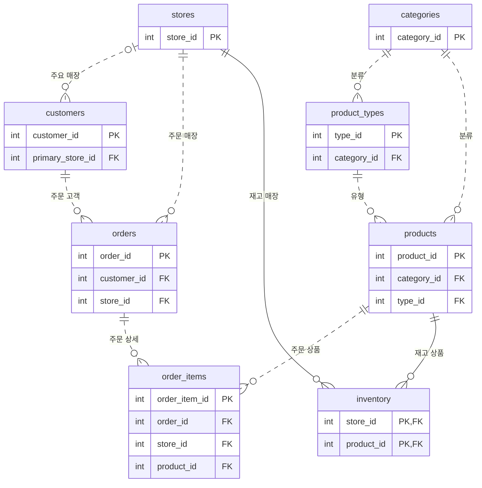

# Zava Retail 데이터 설명서

Zava Retail의 매장·상품·고객·주문·재고 데이터를 설명합니다. 파일별 구성과 열의 의미, 테이블 관계, 데이터를 해석할 때 알아야 할 특성을 확인할 수 있습니다.

## 제공 파일

| 파일 | 행 수 | 내용 |
| :--- | ---: | :--- |
| [stores.csv](source/stores.csv) | 8 | 매장 |
| [categories.csv](source/categories.csv) | 9 | 상품 분류 |
| [product_types.csv](source/product_types.csv) | 89 | 분류별 상품 유형 |
| [products.csv](source/products.csv) | 424 | 공용 상품 카탈로그 |
| [customers.csv](source/customers.csv) | 50,000 | 고객과 주요 매장 |
| [orders.csv](source/orders.csv) | 197,665 | 주문의 고객·매장·주문일 |
| [order_items.csv](source/order_items.csv) | 414,241 | 주문 상세와 거래 금액 |
| [inventory.csv](source/inventory.csv) | 3,392 | 매장별 상품 재고 |

헤더를 제외한 총 **665,828행**입니다.

## 테이블 관계도

다음 ERD(Entity–Relationship Diagram)는 테이블의 주요 키와 관계를 보여 줍니다.

PK는 기본 키(Primary Key), FK는 외래 키(Foreign Key)입니다. 재고의 두 열은 함께 복합 기본 키(Composite Primary Key)를 이룹니다. 선 끝의 원은 0, 막대는 1, 갈래는 여러 행을 뜻합니다. 예를 들어 고객은 주문이 없거나 여러 건일 수 있고, 각 주문은 고객 한 명을 참조합니다. 고객의 주요 매장은 지정하지 않을 수도 있습니다.

점선은 참조 키가 자식 테이블의 기본 키에 포함되지 않는 관계, 실선은 포함되는 관계입니다. 주문 상세는 `(order_id, store_id)`를 함께 사용해 주문을 참조하고, 상품은 `(type_id, category_id)`를 함께 사용해 상품 유형을 참조합니다.

## 열 설명

열 순서는 CSV 헤더와 같습니다. 값 형식은 CSV에 담긴 값의 표현을 설명합니다.

### 매장 — stores.csv

| 열 | 값 형식 | 의미 |
| :--- | :--- | :--- |
| `store_id` | 정수 | 매장 ID |
| `store_name` | 문자열 | 매장명 |
| `rls_user_id` | UUID | 매장별 RLS 사용자 매핑 식별자 |
| `is_online` | `t` / `f` | 온라인 매장 여부 |

매장 ID 1~7은 오프라인 매장이고, 8은 온라인 매장입니다.

### 상품 분류 — categories.csv

| 열 | 값 형식 | 의미 |
| :--- | :--- | :--- |
| `category_id` | 정수 | 분류 ID |
| `category_name` | 문자열 | 분류명 |

### 상품 유형 — product_types.csv

| 열 | 값 형식 | 의미 |
| :--- | :--- | :--- |
| `type_id` | 정수 | 상품 유형 ID |
| `category_id` | 정수 | 유형이 속한 분류 ID |
| `type_name` | 문자열 | 상품 유형명 |

### 상품 — products.csv

| 열 | 값 형식 | 의미 |
| :--- | :--- | :--- |
| `product_id` | 정수 | 상품 ID |
| `sku` | 문자열 | 상품 코드(SKU) |
| `product_name` | 문자열 | 상품명 |
| `category_id` | 정수 | 상품 분류 ID |
| `type_id` | 정수 | 상품 유형 ID |
| `cost` | 소수점 이하 2자리 | 원가 |
| `base_price` | 소수점 이하 2자리 | 공용 카탈로그의 기본 가격 |
| `gross_margin_percent` | 소수점 이하 2자리 | 마진 비율 |
| `product_description` | 문자열 | 상품 설명 |

### 고객 — customers.csv

| 열 | 값 형식 | 의미 |
| :--- | :--- | :--- |
| `customer_id` | 정수 | 고객 ID |
| `first_name` | 문자열 | 이름 |
| `last_name` | 문자열 | 성 |
| `email` | 문자열 | 고객 이메일 |
| `phone` | 문자열 | 전화번호 |
| `primary_store_id` | 정수 | 고객의 주요 매장 ID |
| `created_at` | 날짜와 시각, 시간대 없음 | 고객 생성 시각 |

### 주문 — orders.csv

| 열 | 값 형식 | 의미 |
| :--- | :--- | :--- |
| `order_id` | 정수 | 주문 ID |
| `customer_id` | 정수 | 주문 고객 ID |
| `store_id` | 정수 | 주문이 발생한 매장 ID |
| `order_date` | `YYYY-MM-DD` | 주문일 |

### 주문 상세 — order_items.csv

| 열 | 값 형식 | 의미 |
| :--- | :--- | :--- |
| `order_item_id` | 정수 | 주문 상세 ID |
| `order_id` | 정수 | 상위 주문 ID |
| `store_id` | 정수 | 상위 주문과 일치하는 매장 ID |
| `product_id` | 정수 | 판매한 상품 ID |
| `quantity` | 정수 | 판매 수량 |
| `unit_price` | 소수점 이하 2자리 | 주문 단가 |
| `discount_percent` | 정수 | 할인율 |
| `discount_amount` | 소수점 이하 2자리 | 할인 금액 |
| `total_amount` | 소수점 이하 2자리 | 주문 상세의 거래 금액 |

### 재고 — inventory.csv

| 열 | 값 형식 | 의미 |
| :--- | :--- | :--- |
| `store_id` | 정수 | 재고를 보유한 매장 ID |
| `product_id` | 정수 | 재고 상품 ID |
| `stock_level` | 정수 | 현재 재고 수량 |

## 데이터 해석 시 유의사항

### 상품 가격과 거래 금액

`products.base_price`는 공용 상품의 기본 가격이고, `order_items.unit_price`는 주문 시 적용된 **주문 단가**입니다. 과거 거래를 현재 기본 가격으로 다시 계산하지 않습니다. 매출 집계에는 주문 상세에 저장된 `total_amount`를 사용합니다.

일부 상세의 저장 금액은 `quantity × unit_price − discount_amount`와 최대 0.03 차이가 납니다. 제공된 열만으로 계산 정밀도나 반올림 순서를 확정할 수 없으므로 값을 보정하지 않습니다. 관련 건수와 금액 합계는 [검증 메타데이터](manifest.json)에 있습니다.

### 주요 매장과 주문 매장

`customers.primary_store_id`는 고객의 주요 매장이고, `orders.store_id`는 실제 주문 매장입니다. 주요 매장과 다른 매장에서 주문한 고객은 40,951명이며, 두 값은 서로 다른 관계를 나타냅니다.

### 날짜와 재고의 범위

주문일은 **2020-01-01~2026-12-31**입니다. 실행 시점을 기준으로 미래 날짜가 있더라도 임의로 삭제하지 않습니다.

현재는 모든 매장에 상품 424개씩의 재고 행이 있고, 수량은 28~6,625입니다. 이는 제공 데이터의 현황이며, 모든 매장이 항상 모든 상품을 취급해야 한다는 업무 규칙은 아닙니다.

## CSV 형식

| 항목 | 형식 |
| :--- | :--- |
| 인코딩과 줄 끝 | UTF-8, BOM 없음, LF |
| 구분자와 헤더 | 쉼표 구분, 첫 행은 열 이름 |
| 문자열 이스케이프(Escaping) | 쉼표·따옴표·줄바꿈은 표준 CSV 인용 규칙 사용 |
| NULL | `\N`. 빈 문자열과 구분하며, 현재 파일에는 NULL과 빈 문자열이 없음 |
| 불리언(Boolean) | `t` / `f` |
| 금액과 비율 | 십진수 표기. 금액을 부동소수점으로 변환해 다시 저장하지 않음 |
| 생성 시각 | 시간대 정보 없음. UTC로 가정하지 않음 |

고객 파일에는 이름·이메일·전화번호 등 개인 식별 정보(PII)가 있습니다. 원문을 일반 로그나 검증 보고서에 출력하지 않습니다.

## 검증값과 출처

[manifest.json](manifest.json)에서 파일별 열·행 수·크기·SHA-256과 전체·매장별 집계값을 확인할 수 있습니다.

매장별 `visible_customers`는 주요 매장이 해당 매장이거나 해당 매장에 주문한 고객을 중복 없이 센 값입니다. 같은 고객이 여러 매장의 집계에 포함될 수 있으므로 매장별 고객 수의 합은 전체 고객 수와 다를 수 있습니다.

데이터 출처는 [Microsoft의 Retail 샘플 저장소](https://github.com/microsoft/MCP-Server-and-PostgreSQL-Sample-Retail)입니다. MIT License와 저작권 고지는 [LICENSE](LICENSE)에서 확인할 수 있습니다.
