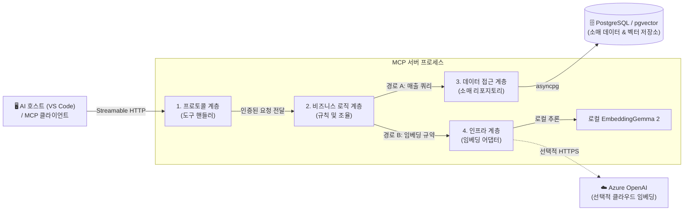
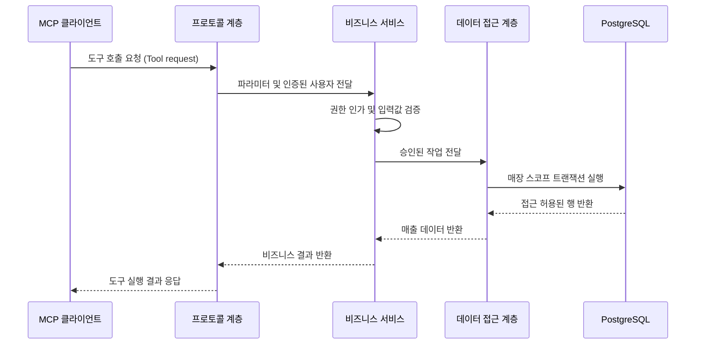
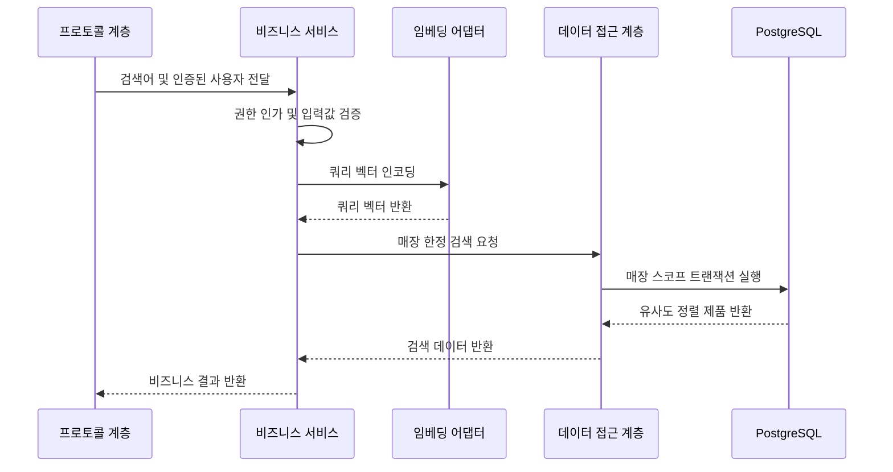

# 핵심 아키텍처: 계층형 MCP 서버 설계 (Core Architecture: Designing a Layered MCP Server)

매장 관리자가 지난달 가장 많이 팔린 제품이 무엇인지 질문합니다. 호스트는 매출 분석 도구를 선택하고, 서버는 PostgreSQL을 조회하여 관리자에게 결과를 반환합니다. 이것이 겉으로 보이는 요청의 흐름입니다. 하지만 이 이면에는 수많은 아키텍처적 결정이 숨어 있습니다. 매출 데이터 접근 권한은 누가 검증하는가? 실행할 쿼리는 누가 결정하는가? 데이터베이스 커넥션은 언제 획득하는가? 그리고 쿼리가 실패했을 때 자원 정리는 누가 책임지는가?

작은 발코니에 적합한 제품을 묻는 두 번째 질문은 이 흐름에 로컬 AI 모델 추론을 추가합니다. 앞선 질문들과 동일한 원칙이 적용되지만, 이제 서버는 여러 요청 간에 모델 메모리와 추론 용량을 공정하게 분배해야 하는 책임까지 맡게 됩니다. 단 한 번의 성공적인 호출에서는 잘 동작하던 설계도 동시 요청이 몰리거나, 클라이언트가 요청을 취소하거나, 서버 시작 시 일부 자원 초기화에 실패하는 상황에서는 완전히 다르게 동작할 수 있습니다.

이번 실습에서는 Zava Retail의 이 두 가지 소매 비즈니스 작업을 중심으로 계층형 아키텍처(Layered Architecture)를 정립합니다. 이 설계의 목표는 전체 서버를 뜯어고치지 않고도 각 결정을 명확히 이해하고, 변경하고, 검증할 수 있는 최적의 위치에 배치하는 것입니다.

## 학습 목표 (What You Will Learn)

이 실습을 마치면 다음을 수행할 수 있게 됩니다:

- 4대 계층의 세부 책임과 계층 간 의존성 규칙을 명확히 설명할 수 있습니다.
- 매출 조회 요청과 시맨틱 검색 요청이 각 계층을 거쳐 처리되는 흐름을 추적할 수 있습니다.
- 사용자 인증(Authentication), 비즈니스 인가(Authorization), 데이터베이스 차원의 강제(Enforcement)를 명확히 구분할 수 있습니다.
- 공유 자원과 요청별 격리 상태에 각각 올바른 소유자와 수명 주기(Lifetime)를 지정할 수 있습니다.
- 장애 상황에서의 시스템 동작과 주요 아키텍처 설계 선택에 따른 트레이드오프(비용과 이점)를 설명할 수 있습니다.

선정된 기술 스택(Python MCP SDK, asyncpg, pgvector가 포함된 PostgreSQL, EmbeddingGemma 2 또는 Azure OpenAI 임베딩)에 대한 배경은 [Lab 00: 입문 가이드 (Introduction)](../00-Introduction/README.md)를 참조하세요. 이번 학습은 목표 아키텍처 설계를 정립하며, 실제 컴포넌트 구현은 이후 실습에서 단계별로 진행합니다.

## 시스템 경계 설정부터 시작하기 (Start with Boundaries)

VS Code와 같은 AI 호스트(Host)는 LLM과 MCP 클라이언트를 조율합니다. LLM은 매장 관리자의 질문을 해석하고 적절한 도구(Tool)를 선택합니다. 클라이언트는 도구 실행 작업과 파라미터(인자)를 MCP 서버로 전송합니다. 서버는 호스트가 안전하지 않은 데이터베이스 코드를 임의로 생성하도록 맡겨두지 않고, 사전에 명확히 정의된 비즈니스 역량(Capability)만을 안전하게 제공합니다.

본 실습에서 다루는 매출 조회와 제품 검색은 입력과 결과의 범위가 정해진 읽기 전용 작업입니다. 각 작업은 신원이 인증된 요청자와 승인된 매장 범위(Store Scope) 내에서 실행됩니다. 한 사용자가 여러 매장에 대한 접근 권한을 가질 수도 있지만, 본 아키텍처 설계에서는 한 번의 개별 작업을 반드시 단 하나의 승인된 매장 스코프 안에서 격리하여 실행합니다.

여기서 반드시 구분해야 할 두 가지 경계가 있습니다. 하나는 MCP 서버와 PostgreSQL을 분리하는 **프로세스 경계(Process Boundary)**입니다. 다른 하나는 서버 내부에서 관련된 책임들을 논리적으로 묶어주는 **논리적 계층(Logical Layer)**입니다. 여러 계층이 단 하나의 프로세스 안에서 함께 동작할 수 있으므로, 새로운 계층을 도입한다고 해서 별도의 마이크로서비스나 컨테이너, 네트워크 요청이 추가로 필요하지는 않습니다.

로컬 임베딩 모델(EmbeddingGemma 2)은 MCP 서버 프로세스 내부에서 직접 구동됩니다. 임베딩 어댑터는 모델의 고유 API를 캡슐화하고, PostgreSQL은 제품 벡터를 저장하고 벡터 유사도 검색을 수행합니다. 대화 모델은 적합한 작업을 판단하고, 임베딩 모델은 텍스트의 수치적 벡터 표현을 생성합니다. 두 모델은 완전히 다른 목적을 가집니다. 본 설계에서 임베딩 제공자를 호출하는 주체는 데이터베이스가 아니라 어디까지나 애플리케이션(MCP 서버)입니다.

현재 채택된 MCP `2026-07-28` 프로토콜에서는 모든 요청이 자체적으로 완결(Self-contained)되며, 프로토콜 차원의 세션이나 초기화 핸드셰이크가 존재하지 않습니다. Streamable HTTP 전송 계층은 요청 범위 내에서 JSON 응답 또는 SSE 스트림을 반환할 수 있습니다. 이러한 프로토콜 특성이 서버 프로세스가 커넥션 풀이나 로드된 모델을 재사용하는 것을 방해하지는 않습니다. 다만 특정 사용자의 신원이 커넥션의 암묵적인 상태로 기억되어서는 안 됨을 의미합니다. 자세한 내용은 [MCP 공식 아키텍처 사양][mcp-architecture]과 [Streamable HTTP 사양][transport]을 참조하세요.

## 4대 계층 구조 (The Four Layers)

본 아키텍처는 프로토콜, 비즈니스 로직, 데이터 접근, 인프라라는 4가지 핵심 영역을 뼈대로 삼습니다. 이는 본 애플리케이션의 내부 설계 구조이며, MCP 프로토콜 자체가 이러한 4개 내부 계층을 강제하는 것은 아닙니다.

실선 화살표는 실제 요청 처리 시의 핵심 호출 관계를 나타내며, 점선 화살표는 선택적 외부 제공자(Azure OpenAI) 연결 경로를 의미합니다. 이는 모든 요청이 4개 단계를 반드시 순서대로 거쳐야 한다는 뜻이 아닙니다. 비즈니스 로직은 일반 매출 조회 시 3계층(데이터 접근)을 거쳐 데이터베이스를 조회하며, 시맨틱 검색 시에는 4계층(인프라)의 임베딩 어댑터를 통해 벡터를 먼저 생성합니다.

### 1계층: 프로토콜 (Layer 1: Protocol)

프로토콜 계층은 비즈니스 작업에 MCP 표준 인터페이스를 제공합니다. 공식 Python SDK가 프로토콜 통신 메커니즘을 처리하며, 도구 핸들러(Tool Handler)는 도구의 입력 형식을 검증하고, 요청에서 인증된 사용자 정보를 확보하며, 적절한 비즈니스 서비스를 호출한 뒤 구조화된 결과나 안전한 오류를 반환합니다.

두 개의 서로 다른 호스트가 동일한 매출 보고서를 요청하는 상황을 생각해 보겠습니다. 대화의 형식이나 프롬프트는 다를 수 있지만, 비즈니스 서비스 계층이 전달받는 정보는 항상 동일해야 합니다. 즉, 조회 기간, 결과 건수 제한, 그리고 신뢰할 수 있는 접근 권한 컨텍스트입니다. 비즈니스 서비스가 보고서 조회를 허용할지 판단하기 위해 채팅 대화 이력이나 SDK의 원시 요청 컨텍스트 객체를 직접 들여다볼 필요는 없습니다.

인증(Authentication)은 요청의 진입 경계에서 처리됩니다. 비즈니스 로직이 시작되기 전에 호출자의 신원을 검증하고 신뢰할 수 있는 접근 정보를 주입합니다. SDK가 제공하는 요청 컨텍스트 객체는 통신 프레임워크 차원의 연결 도구일 뿐, 객체 자체가 존재한다고 해서 신원이 보장되는 것은 아닙니다. 마찬가지로 클라이언트가 파라미터로 넘긴 매장 ID는 사용자의 희망 조회 요청일 뿐, 접근 권한의 증거가 될 수 없습니다.

또한 이 계층은 애플리케이션의 처리 결과를 SDK의 표준 응답 포맷으로 변환합니다. 프로토콜 계층이 SQL을 직접 고르거나 서비스의 비즈니스 규칙을 중복 구현해서는 안 됩니다. 만약 각 도구 핸들러마다 자체적인 매출 조회 권한 검증을 구현한다면, 새로운 도구가 추가될 때마다 인가 정책이 서로 어긋나는 보안 취약점이 발생합니다.

### 2계층: 비즈니스 로직 (Layer 2: Business Logic)

비즈니스 계층은 요청된 작업이 해당 호출자에게 타당한지 판단하고 작업을 조율합니다. 매출 서비스는 매출 접근 권한, 조회 기간 범위, 결과 건수 한도를 검증합니다. 검색 서비스는 카탈로그 접근 권한과 입력 문자열 길이를 검증하고, 쿼리 임베딩을 요청한 뒤 적격 제품 조회를 지시합니다.

이러한 비즈니스 판단은 단순한 입력값 형식 검증과는 다릅니다. 날짜 형식이 올바르더라도 시스템이 허용하지 않는 과거 기간일 수 있습니다. 프로토콜 경계는 데이터의 표현 형식을 다루고, 비즈니스 서비스 계층은 작업의 비즈니스적 타당성과 권한 인가를 다룹니다.

또한 서비스는 '보고서'의 비즈니스적 의미를 정의합니다. 예를 들어 '조회 기간 내 매출액 순으로 제품 순위 매기기'가 그것입니다. 비즈니스 계층이 모든 주문 데이터를 메모리로 퍼 올려 직접 계산할 필요 없이, 소매 리포지토리가 SQL 집계 쿼리를 통해 효율적으로 계산하도록 위임할 수 있습니다. 비즈니스 규칙의 의미를 소유한다는 것이 모든 계산을 비즈니스 계층 메모리에서 직접 수행해야 한다는 뜻은 아닙니다.

서비스는 사용자 인증과 서버 측 권한 데이터를 통해 수립된 신뢰할 수 있는 호출자 정보를 전달받습니다. 클라이언트가 제출한 `store_id`로부터 권한을 임의로 만들어내서는 안 됩니다. 매장 선택 기능이 제공될 때도, 실제 실행 스코프를 생성하기 전에 요청된 매장이 신뢰할 수 있는 권한 목록에 속해 있는지 반드시 대조해야 합니다.

비즈니스 규칙을 이 계층에 집중시키면 여러 도구에서 규칙을 안전하게 재사용할 수 있습니다. 또한 중요한 아키텍처적 검증이 가능해집니다. 즉, MCP 네트워크 전송이나 데이터베이스 없이도 매출 권한 검증 정책을 독립적으로 단위 테스트할 수 있는가? 정책 검증만을 위해 이러한 외부 시스템이 반드시 필요하다면, 경계 간에 불필요한 결합이 존재한다는 증거입니다.

서비스 계층은 '매출 데이터 조회'나 '쿼리 벡터 생성' 같은 추상화된 작업에 의존합니다. asyncpg가 커넥션을 어떻게 대여하는지, 모델 라이브러리가 가중치 파일을 어떻게 읽는지는 알 필요가 없습니다. 이러한 계약을 정의하기 위해 거대한 클래스 상속 계층을 만들 필요는 없으며, 단순한 함수나 작은 인터페이스만으로도 충분히 책임을 분리할 수 있습니다.

### 3계층: 데이터 접근 (Layer 3: Data Access)

데이터 접근 계층은 승인된 비즈니스 작업을 실제 데이터베이스 쿼리로 변환합니다. 소매 리포지토리는 구체적인 SQL 쿼리를 소유하고, 파라미터를 바인딩하며, 커넥션을 대여(Lease)하고, 트랜잭션 범위 안에서 승인된 매장 스코프를 적용합니다. 그런 다음 서비스가 라이브 DB 커넥션을 붙잡고 있지 않고도 사용할 수 있도록, 드라이버 종속적이지 않은 독립된 데이터 형태로 결과를 반환합니다.

본 실습에서는 임의의 SQL이 아닌 구조화된 매출 및 검색 도구만을 노출합니다. 이는 의도적인 역량 제한입니다. 리포지토리는 어떤 쿼리가 허용되는지 정확히 알고 있으며, 입력값, 실행 비용, 결과 형태를 사전에 제어할 수 있습니다. 파라미터 바인딩은 승인된 쿼리 내부의 값을 보호할 뿐, 임의의 SQL 문자열이 MCP 도구를 거쳤다고 해서 안전해지는 것은 아닙니다.

리포지토리는 이미 권한이 검증된 매장 스코프를 PostgreSQL로 전달할 뿐, 사용자 신원을 인증하거나 매장 접근 권한을 스스로 결정하지 않습니다. 데이터베이스의 행 수준 보안(RLS)이 현재 실행 역할에 맞춰 테이블 행 보안 정책을 최종 강제합니다. 인증, 비즈니스 인가, 데이터베이스 강제는 서로 다른 3계층의 통제 장치로 명확히 분리되어 동작합니다.

또한 데이터 접근 계층은 커넥션과 트랜잭션의 정리 책임을 한곳에 모아줍니다. 만약 도구 핸들러가 커넥션을 열고 서비스가 닫는 시점을 결정한다면 자원 소유권이 계층 간에 파편화됩니다. 리포지토리가 일시적 DB 자원을 획득하고, 모든 정상/예외 종료 경로에서 자원의 안전한 반환을 확실히 보장해야 합니다.

### 4계층: 인프라 (Layer 4: Infrastructure)

인프라 계층은 기술적 구현체와 공통 지원 기능을 제공합니다. 검증된 환경설정, 수명 주기(Lifespan) 관리, 시스템 진단 및 모니터링, 임베딩 어댑터가 여기에 포함됩니다. 이러한 책임들이 이곳에 모여 있는 이유는 애플리케이션의 비즈니스 작업을 특정 런타임 및 외부 서비스와 연결해 주는 역할을 하기 때문입니다. 모든 요청이 반드시 거쳐야 하는 최종 단계가 아닙니다.

임베딩 어댑터는 서비스 계층의 쿼리 임베딩 규약을 구현합니다. 제공자별 초기화, 태스크 프롬프트 구성, 추론 스케줄링 및 출력 벡터 검증을 전담합니다. 비즈니스 서비스는 언제 임베딩이 필요한지만 결정하며, 선택된 제공자가 벡터를 어떻게 생성하는지는 어댑터가 전담합니다. 향후 임베딩 제공자를 변경하더라도 매출 권한 검증이나 MCP 도구 스키마를 수정할 필요가 없습니다.

애플리케이션 시작 단계(Startup)에서 서비스들을 생성하고 리포지토리 및 어댑터와 연결합니다. 또한 공유 자원의 수명 주기를 책임집니다. 이후 들어오는 요청들은 미리 준비된 이 의존성들을 대여하여 사용합니다. 새로운 도구 호출이 들어올 때마다 환경설정을 다시 읽거나 모델을 매번 새로 로드해서는 안 됩니다.

로컬 모델을 사용하면 별도의 전용 추론 서비스와 네트워크 경계를 둘 필요가 없습니다. 그 대신 MCP 서버 프로세스가 모델 메모리와 추론 처리 용량을 직접 관리해야 하는 비용이 발생합니다. 원격 클라우드 제공자로 전환하면 이러한 인프라 부담은 덜 수 있지만, 네트워크 장애와 외부 가용성 문제가 새롭게 발생합니다. 어댑터는 API 호출 방식의 차이를 격리해 줄 뿐, 이러한 운영상의 특성 차이까지 없애주는 것은 아닙니다.

### 계층 경계를 넘어 전달되는 정보와 은닉되는 세부 구현

계층 경계가 성립하려면 이름뿐만 아니라 명확한 계약(Contract)이 필요합니다. 이 규약은 작업에 꼭 필요한 비즈니스 정보만을 전달하며, 각 계층의 내부 구현 세부 사항은 경계 뒤에 철저히 은닉합니다.

| 계층 경계 | 전달되는 정보 (Information passed) | 경계 뒤에 은닉되는 세부 사항 (Details kept behind) |
| :--- | :--- | :--- |
| **프로토콜 $\rightarrow$ 비즈니스 서비스** | 비즈니스 요청 파라미터 및 인증된 사용자 권한 범위 | 프로토콜 프레이밍(Protocol Framing), 자격 증명, SDK 컨텍스트 |
| **비즈니스 서비스 $\rightarrow$ 리포지토리** | 승인된 작업, 조회 조건 및 인가된 매장 스코프 | 구체적 SQL, 커넥션 대여(Lease), 트랜잭션, DB 드라이버 타입 |
| **비즈니스 서비스 $\rightarrow$ 임베딩 어댑터** | 검색어 텍스트 및 합의된 임베딩 작업 규약 | 외부 제공자 API, 모델 로딩 방식, 추론 스케줄링 |

처리 결과는 동일한 경계를 거슬러 올라가며 애플리케이션 데이터로 변환됩니다. 오류 역시 그 의미를 가장 잘 이해할 수 있는 경계에서 분류되어 적절한 형태로 변환됩니다. 아키텍처 다이어그램에 표현된 호출 관계를 유지하더라도, 비즈니스 규칙이 구체적인 데이터베이스 드라이버나 AI 모델 라이브러리를 직접 import할 필요는 없습니다.

계층 분리에는 비용이 따릅니다. 비즈니스 기능이 확장됨에 따라 계층 간 규약과 데이터 매핑 코드를 함께 유지보수해야 합니다. 하지만 그 대가로 각 변경 사항을 수정할 명확하고 독립적인 위치를 얻게 됩니다. 고유한 책임이 없는 불필요한 컴포넌트를 남발하지 않으면서, 경계를 명확하게 유지하는 것이 핵심입니다.

## 요청 흐름 추적 (Follow the Requests)

계층 구조 다이어그램이 각 책임의 위치를 설명한다면, 실제 요청 흐름을 추적해 보면 왜 이러한 배치가 중요한지 알 수 있습니다. 아래의 두 가지 흐름은 모두 요청 진입 경계에서 사용자 신원 인증이 이미 성공했다고 가정합니다. 권한 검증에 실패한 요청은 비즈니스 쿼리나 AI 모델 추론이 시작되기 전에 조기에 차단됩니다.

### 1. 매출 보고서 조회 흐름 (A Sales Report)

매장 관리자가 지난달 상위 매출 제품을 요청합니다. 호스트는 매출 도구를 선택하고 조회 기간과 결과 건수 제한을 전달합니다. 서버는 이 입력 파라미터와 독립적으로 호출자의 신뢰할 수 있는 매장 권한 범위를 수립하며, AI 모델이 전달한 인자에서 권한을 임의로 가져오지 않습니다.

비즈니스 서비스는 허용되지 않은 보고서 요청이나 유효하지 않은 기간 범위를 DB 커넥션을 획득하기 **전에** 미리 거절합니다. 검증을 통과하면 리포지토리가 커넥션 풀에서 하나의 커넥션을 대여하고, 트랜잭션을 시작하며, 승인된 매장 스코프를 설정한 뒤 쿼리를 실행합니다. 데이터 조회가 끝나면 트랜잭션을 종료하고 커넥션을 즉시 풀에 반환한 후에 데이터를 서비스 계층으로 넘깁니다.

서비스 계층은 데이터베이스 커넥션을 불필요하게 점유하지 않고도 보고서 데이터를 가공하거나 조립할 수 있습니다. 프로토콜 계층은 호스트가 사용자에게 답변할 수 있는 표준 결과로 변환하여 응답합니다. 호스트나 비즈니스 서비스 모두 어떤 물리적 DB 커넥션이 쿼리를 실행했는지 알 필요가 없습니다.

### 2. 시맨틱 제품 검색 흐름 (A Semantic Product Search)

발코니에 적합한 제품을 찾는 질문은 다른 방식으로 처리됩니다. 검색을 서비스하기 전에, 카탈로그 데이터 수집(Ingestion) 단계에서 제품 설명문들이 이미 임베딩 벡터로 변환되어 데이터베이스에 저장되어 있습니다. 실시간 검색 요청은 오직 사용자의 검색어 쿼리만을 벡터로 인코딩하여 기존에 저장된 제품 벡터들과 비교합니다.

여기서 핵심은 **리포지토리가 데이터베이스 커넥션을 대여하기 전에 비즈니스 서비스가 쿼리 벡터를 먼저 확보하는 것**입니다. 그렇지 않으면 느린 AI 추론 연산이 진행되는 동안 데이터베이스 커넥션이 아무 일도 하지 않으면서 유휴 상태로 묶이게 됩니다. 검색 요청이 여러 개 동시에 들어오면, PostgreSQL 자체의 부하는 적더라도 일반 매출 조회 쿼리들까지 커넥션을 얻지 못해 지연되는 병목이 발생합니다. 호출 순서를 엄격히 제어하여 무관한 작업으로부터 공유 자원을 보호해야 합니다.

본 설계에서 EmbeddingGemma 2 모델은 기본 768차원 벡터를 생성합니다. 어댑터는 예상 차원, 유한한 실수 값, 코사인 유사도 검색을 위한 0이 아닌 벡터 규격을 검증합니다. 데이터 수집과 검색은 호환되는 모델 리비전, 전처리 방식, 그리고 적절한 문서/쿼리 프롬프트를 일관되게 사용해야 합니다. 단순히 벡터 차원 숫자만 같다고 해서 호환성이 성립하는 것은 아닙니다. 자세한 내용은 [공식 모델 가이드][embedding-guide]를 참조하세요.

따라서 임베딩 제공자를 교체하는 것은 API뿐만 아니라 저장된 데이터 전체에 영향을 미칩니다. 기존 카탈로그 벡터들을 무관한 다른 모델의 벡터와 직접 비교할 수 없으므로, 카탈로그 임베딩 전체를 다시 생성해야 할 수 있습니다. 어댑터는 제공자 API를 추상화해 주지만, 저장된 데이터의 호환성 결정은 애플리케이션의 핵심 책임으로 남습니다.

### 매장에 귀속되는 데이터와 공용 데이터의 구분

주문 내역, 매출 데이터, 매장별 취급 상품 목록은 특정 매장에 귀속되는 데이터입니다. 본 예제에서는 일반적인 제품 이름과 기본 설명을 모든 매장이 공유하는 공용 카탈로그로 취급합니다. 하지만 시맨틱 검색 결과는 해당 매장에 입점되어 접근 권한이 부여된 제품들로 엄격히 제한되어야 합니다.

만약 제품 설명이나 벡터 자체에 매장의 비공개 정보가 포함되어 있다면, 공유 데이터라는 전제는 더 이상 유효하지 않습니다. 해당 레코드들 역시 매장별 소유권과 접근 제어 규칙을 적용받아야 합니다. 데이터베이스 테이블 관계 역시 매장 소유권을 철저히 보존해야 하며, 주문 항목이 다른 매장의 주문을 참조하는 일이 없어야 합니다. 단순한 `store_id` 컬럼 하나가 데이터베이스 무결성 관계나 파티셔닝을 자동으로 만들어주지 않습니다.

RLS는 보안 대상 테이블에 반드시 활성화되어야 하며, 실제 운영 런타임 역할을 통해 철저히 검증되어야 합니다. 슈퍼유저, `BYPASSRLS` 권한 보유자, 그리고 기본적으로 테이블 소유자 계정은 RLS 정책을 우회합니다. 애플리케이션은 권한이 제한된 DB 계정을 사용해야 하며, 유효한 매장 스코프가 없을 때는 조회를 원천 차단하는 정책을 구성해야 합니다. 행 수준 필터링은 사람의 신원을 인증해 주지 못하며, 애플리케이션이 잘못 주입한 비정상 스코프를 대신 수정해 주지도 못합니다. 자세한 내용은 [PostgreSQL 행 보안 문서][rls]를 참조하세요.

## 자원 공유와 상태 격리 (Share Resources, Isolate State)

데이터베이스 커넥션 풀과 로드된 AI 모델은 매 호출마다 새로 만들기에는 너무나 무거운 고비용 자원입니다. 반면 호출자의 신원과 매장 권한 범위는 요청 간에 조금이라도 공유되면 심각한 보안 사고를 유발하는 위험한 상태입니다. 이 두 명제가 모두 참일 수 있는 이유는 자원과 상태가 서로 다른 소유자와 수명 주기를 갖기 때문입니다.

| 자원 또는 상태 | 소유자 | 수명 주기 (Lifetime) |
| :--- | :--- | :--- |
| **환경설정 및 DB 커넥션 풀** | 인프라 계층의 애플리케이션 수명 주기 (Lifespan) | 서버 프로세스당 1회 준비되며 프로세스 종료 시 해제 |
| **로컬 모델 및 추론 처리 용량** | 수명 주기 내 임베딩 어댑터 | 여러 요청 간에 공유되며 잔여 작업 처리(Draining) 후 해제 |
| **호출자 신원 및 승인된 매장 스코프** | 요청 인증 및 비즈니스 인가 계층 | 단일 요청 또는 단일 승인 작업 동안만 유지 |
| **대여한 DB 커넥션 (Leased Connection)** | 리포지토리 메서드 실행 단위 | 데이터베이스 쿼리를 수행하는 짧은 순간 동안만 유지 |
| **트랜잭션 및 매장 컨텍스트** | 리포지토리 메서드 실행 단위 | 대여한 해당 커넥션 위의 단일 명시적 트랜잭션 동안만 유지 |
| **선택적 외부 제공자 클라이언트** | 지정된 임베딩 어댑터 | 어댑터의 전체 수명 동안 유지 |

### 커넥션은 재사용하되, 사용자 상태는 재사용하지 말 것

A 매장의 요청이 끝나 커넥션을 풀에 반환했다고 가정해 보겠습니다. 풀은 바로 다음 요청인 B 매장의 요청에 동일한 물리적 커넥션을 할당할 수 있습니다. 만약 A 매장의 스코프가 커넥션의 영구적인 상태로 남아 있고 B 매장이 자체 스코프를 설정하지 않는다면, B 매장의 쿼리가 A 매장의 권한으로 실행되는 치명적인 데이터 누출이 발생합니다. 전역 변수에 현재 매장을 저장하는 방식 역시 동시 요청들이 서로의 상태를 덮어쓸 수 있어 매우 위험합니다.

따라서 리포지토리는 반드시 **명시적 트랜잭션 내부에서만 유효한 트랜잭션 범위 설정(Transaction-local setting)으로 승인된 스코프를 적용**하고, 바로 그 커넥션과 트랜잭션 안에서 쿼리를 실행해야 합니다. 트랜잭션이 종료되면 PostgreSQL은 이전 설정 상태로 자동 복원합니다. 풀에는 복원해야 할 어떠한 영구적인 호출자 신원도 남아 있어서는 안 되며, 이후 들어오는 모든 작업은 쿼리를 실행하기 전에 항상 자신만의 스코프를 새롭게 수립해야 합니다. 커넥션 풀의 리셋 기능은 2차 방어선일 뿐, 주된 격리 메커니즘이 되어서는 안 됩니다. 자세한 내용은 [PostgreSQL 트랜잭션 로컬 설정][db-settings]을 참조하세요.

정상 완료 시 읽기 트랜잭션이 커밋되고 커넥션이 풀로 반환됩니다. 장애나 취소가 발생하면 작업을 롤백하고 커넥션 대여를 해제해야 하며, 물리적으로 손상된 연결은 즉시 폐기되어야 합니다. 한 커넥션에 매장 컨텍스트를 설정해 두고 다른 커넥션에서 쿼리를 실행하는 것은 개별 쿼리가 아무리 완벽해 보여도 아키텍처 경계를 완전히 깨뜨리는 행위입니다.

### 작업을 수락하기 전에 자원을 미리 준비할 것

애플리케이션 수명 주기(Lifecycle)는 필수 환경설정을 검증하고, 풀을 생성하며, 선택된 모델 어댑터를 초기화합니다. Python SDK의 [수명 주기(Lifespan) 관리 기능][lifespan]은 이러한 준비 및 정리 작업을 실행 중인 서버와 연결해 줍니다. 핸들러들은 매 호출마다 풀이나 모델을 새로 생성하지 않고, 미리 준비된 의존성들을 대여하여 사용합니다.

만약 커넥션 풀은 열렸지만 모델 로딩에 실패했다고 가정해 보겠습니다. 서버 시작은 실패했지만 데이터베이스 자원은 이미 메모리에 할당되어 있습니다. 수명 주기 관리자는 커넥션 풀을 닫고, 어댑터가 실패한 초기화 과정에서 할당했던 메모리를 남김없이 정리해야 합니다. 자원 정리는 정상 종료뿐만 아니라 부분적인 시작 실패 상황도 완벽히 포괄해야 합니다.

진정한 준비 상태(Readiness)란 단순히 HTTP 포트가 열려 있다는 의미가 아니라, 서버에 요구되는 핵심 역량을 즉시 수행할 수 있음을 의미합니다. 시작 점검에서는 데이터베이스 연결 가능 여부, 데이터와 벡터 기대치의 호환성, 정상적인 모델 추론 동작을 검증해야 합니다. 필수 모델 초기화에 실패한 서버가 준비 완료 상태라고 외부에 알려서는 안 됩니다. 축소된 기능만으로 서비스를 제공하려면 그에 맞는 별도의 아키텍처 설계가 필요합니다.

### 취소된 요청에도 여전히 실행 중인 작업이 남아 있을 수 있다

로컬 AI 추론은 동기식 CPU 또는 GPU 런타임을 사용할 수 있습니다. 이러한 블로킹 연산은 비동기 요청 이벤트 루프를 멈추게 하지 않도록 별도의 워커에 적절히 스케줄링되어야 합니다. 어댑터는 현재 실행 중인 작업과 큐에 대기 중인 작업 모두에 **요청 수락 제한(Admission Limits)**을 두어야 합니다. 추론 작업을 단순히 스레드로 보낸다고 해서 저절로 부하가 제한되는 것은 아닙니다.

요청 취소(Cancellation) 역시 중요한 경계입니다. 클라이언트가 대기를 멈추고 연결을 끊더라도 백그라운드 스레드나 디바이스에서 돌고 있는 추론 연산은 계속 실행될 수 있습니다. 서버는 취소된 요청에 대한 후속 데이터베이스 조회를 건너뛰어야 하지만, 이미 실행 중인 추론 작업이 실제로 완전히 끝날 때까지 해당 자원 슬롯을 계속 추적해야 합니다. 자원 슬롯을 너무 일찍 반환해 버리면 모델이 감당할 수 있는 것보다 더 많은 동시 작업이 밀려들어 과부하가 발생합니다. 이는 취소 동작에 제약이 있는 [비동기 Executor 작업 취소][cancellation]의 표준 특성을 따릅니다.

서버 종료 시에는 먼저 신규 요청의 진입을 차단하고, 실행 중인 요청들을 완료하거나 취소하며, **진행 중인 추론의 잔여 작업 처리(Draining)**를 마친 후 모델 자원을 해제합니다. 종료 제한시간(Deadline)을 설정하여 무한 대기를 방지해야 합니다. 잔여 작업 정리가 제시간에 끝나지 않아 강제 종료(Forced Termination)가 필요하다면, 이를 정상적인 정상 종료(Graceful Cleanup)로 포장해서는 안 됩니다. 하나의 자원이 닫히지 않더라도 독립적인 나머지 자원들은 끝까지 정상 해제를 시도해야 합니다.

서버 프로세스를 증설할 때마다 수명 주기 관리자, 커넥션 풀, 그리고 로컬 모델 인스턴스가 프로세스 수만큼 복제됩니다. 프로세스가 늘어나면 동시 처리량은 증가하지만, 데이터베이스 연결 수와 모델 메모리 사용량도 배수로 급증합니다. 용량 산정은 프로세스 재시작 시 일시적으로 겹치는 중복 프로세스까지 고려하여 전체 배포 인프라 관점에서 총합을 계산해야 합니다.

## 적절한 경계에서의 장애 처리 (Let Failures End at the Right Boundary)

성숙한 오류 처리 모델은 시스템이 내려야 하는 판단에서 출발합니다. 이 요청은 인가되지 않은 요청인가? 입력 형식이 부적절한가? 외부 종속성이 다운되었는가? 클라이언트가 취소했는가? 아니면 서버가 준비되기도 전에 시작 단계에서 실패했는가? 이 범주들은 설령 최종적으로 모두 에러 응답을 반환하더라도 서로 다른 대응을 필요로 합니다.

진입 경계는 잘못된 인증을 거절합니다. 비즈니스 서비스는 허용되지 않거나 부적절한 비즈니스 작업을 거절합니다. 리포지토리는 데이터베이스 작업을 롤백하고 커넥션을 정리하며, 어댑터는 모델 자원을 정산합니다. 프로토콜 계층은 내부 애플리케이션 오류를 안전한 도구 결과로 변환하고, SDK는 통신 프로토콜 수준의 결함을 처리합니다. 이러한 책임을 명확히 하기 위해 복잡한 예외 클래스 상속 트리를 만들 필요는 없습니다.

프로토콜 오류와 도구 실행 오류는 엄격히 구분되어야 합니다. MCP 프로토콜에서 프로토콜 오류는 규격에 맞지 않는 잘못된 형식의 요청 등 통신 프로토콜 자체의 문제에 사용됩니다. 반면 비즈니스 규칙 위반이나 도구 입력 오류를 포함한 실행 실패는 정상적인 도구 오류 결과(Tool error result)로 보고됩니다. 모든 실패를 동일한 HTTP 상태 코드로 매핑하거나 임의의 독자적인 JSON-RPC 코드를 발명하지 마십시오. 자세한 내용은 [MCP 도구 오류 처리 규격][errors]을 참조하세요.

지연되는 작업이 자원을 무한정 독점해서는 안 됩니다. 모델 추론 시간, 커넥션 획득 대기 시간, 데이터베이스 실행 시간에 각각 독립적인 타임아웃을 두고, 전체 요청에 대한 글로벌 타임아웃을 함께 적용해야 합니다. 재시도(Retry)는 해당 작업이 다시 실행해도 안전한 멱등성을 가지며 실패가 일시적인 경우에만, 전체 타임아웃 예산 범위 내에서 신중히 적용해야 합니다. 권한 부족이나 스키마 불일치는 재시도한다고 해서 해결되지 않습니다.

내부 장애는 사용자에게 노출되는 정보와 운영자에게 필요한 정보를 분리해야 합니다. 호출자에게는 안전하고 유용한 결과만 전달해야 하며, 운영자에게는 통제된 진단 정보가 제공되어야 합니다. 데이터베이스 접속 주소, 비밀번호, 원시 검색어 텍스트, 고객 개인정보는 일반적인 에러 메시지나 로그에 절대 남겨서는 안 됩니다. 감사 로그(Audit Record)는 "누가 어떤 데이터에 접근했는가"를 기록하기 위한 독립적인 보안 설계가 필요하며, RLS나 생성 시간 컬럼만으로 완전한 감사 기록을 자동으로 대신할 수는 없습니다.

## 데이터 기반의 신중한 최적화 (Choose Optimizations from Evidence)

검색 응답이 느려졌다면 AI 모델 추론 대기 큐, 실제 추론 연산, DB 커넥션 획득 대기, 쿼리 실행 중 어느 단계에서 병목이 생겼는지 전체 응답 시간만으로는 알 수 없습니다. 각 경계 구간마다 소요 시간과 처리 결과를 독립적으로 계측하고, 이를 단일 요청 ID로 연계하여 추적할 수 있어야 합니다.

이러한 관측 데이터는 올바른 인프라 변경을 이끌어냅니다. 커넥션 풀 대기가 길어졌다고 해서 무작정 풀 크기를 늘리면 과부하 상태인 데이터베이스를 더 악화시킬 수 있습니다. 모델 큐가 증가한다면 DB 증설이 아니라 요청 수락 제한(Admission Limits)을 강화하거나 추론 용량을 늘려야 합니다. 준비 상태(Readiness)는 서버의 핵심 역량이 정상인지 나타내야 하고, 활성 상태(Liveness)는 프로세스 자체가 살아있는지를 나타냅니다. 사용되지 않는 선택적 클라우드 제공자의 일시 장애가 필수 로컬 파이프라인의 헬스체크를 실패하게 만들어서는 안 됩니다.

인덱스는 검색 시 수행되는 작업 방식을 바꿉니다. 처음에는 명확하고 정확한 검색 동작부터 시작하고, 대표성 있는 실제 데이터를 바탕으로 근사 인덱스(HNSW, IVFFlat)의 효과를 평가해야 합니다. 근사 인덱스는 검색 속도를 높여주지만, 특히 매장 필터링이 결합될 때 검색 결과의 정확도에 영향을 줄 수 있습니다. 응답 속도와 검색 품질을 반드시 함께 측정해야 하며, 속도만 빠르고 정작 연관된 제품을 놓치는 쿼리는 좋은 결과가 아닙니다. 자세한 내용은 [pgvector 필터링 가이드][vector-filtering]를 참조하세요.

캐싱(Caching)은 응답에 도달하는 경로를 바꿉니다. A 매장의 권한으로 캐시된 결과를 B 매장이 동일한 쿼리 파라미터로 요청했다고 해서 그대로 반환해서는 절대로 안 됩니다. 캐시는 권한 범위를 인식하는 캐시 키(Scope-aware keys), 캐시 히트 시의 권한 재검증, 그리고 데이터 및 권한 변경 시의 무효화 정책을 반드시 갖추어야 합니다. 초기 아키텍처에서는 기본 경계가 완전히 검증되기 전에 이러한 복잡성을 피하기 위해 캐싱을 의도적으로 배제합니다. 측정 데이터를 통해 캐싱의 실익이 복잡성을 상쇄한다고 입증될 때 도입하십시오.

## 구현 전 자가 점검 (Check the Design Before Implementing It)

좋은 아키텍처는 시스템의 변경이나 장애를 명확히 설명할 수 있어야 합니다. 다음 질문들을 통해 학습한 내용을 점검해 보세요:

1. 새로운 매출 분석 도구가 추가될 때, 기존 비즈니스 서비스의 규칙 중 어떤 것을 재사용할 수 있으며, 프로토콜 핸들러에는 어떤 로직만 남겨야 하나요?
2. 호출자가 자신이 접근할 수 없는 매장을 선택했을 때, 요청은 어느 계층에서 거절되며, 어떤 고비용 작업들이 실행되지 않고 절약되나요?
3. B 매장의 요청이 이전에 A 매장이 사용했던 커넥션을 재사용할 때, B의 쿼리가 실행되기 전에 반드시 만족되어야 하는 조건은 무엇이며, 이전 작업의 어떤 상태가 절대로 남아 있어서는 안 되나요?
4. 임베딩 제공자를 교체할 때, 어댑터 계층을 통해 손쉽게 교체할 수 있는 부분은 무엇이며, 여전히 애플리케이션이 책임져야 하는 저장 데이터 호환성 문제는 무엇인가요?
5. AI 추론이 실행 중인 도중에 요청이 취소된 경우, 백그라운드 작업을 추적해야 하는 주체는 누구이며, 왜 자원 슬롯을 즉시 반환해서는 안 되나요?
6. 커넥션 풀이 생성된 직후 모델 로딩에 실패한 경우, 자원 정리는 누가 담당하며, 서버의 준비 상태(Readiness)는 어떻게 보고되어야 하나요?

비즈니스 서비스 규칙은 MCP 네트워크 통신이나 AI 모델 런타임 없이도 독립적으로 단위 테스트가 가능해야 합니다. 리포지토리의 테넌트 격리는 권한이 제한된 실제 PostgreSQL 역할을 사용하여 검증해야 합니다. 수명 주기 점검은 부분 시작 실패, 요청 취소, 자원 정리 실패 시나리오를 포괄해야 합니다. 이 테스트들은 서로 다른 경계를 검증하며, 단 한 번의 성공적인 도구 호출만으로는 이 모든 안정성을 입증할 수 없습니다.

## 핵심 요약 (Key Takeaways)

- **계층형 아키텍처 (Layered architecture):** 프로토콜, 비즈니스 로직, 데이터 접근, 인프라는 각각 고유한 책임과 명확한 데이터 전달 규약을 가집니다. 인프라는 요청 흐름의 마지막 단계가 아니라 각 계층을 지탱하는 지원 기반입니다.
- **데이터베이스 경계 (Database boundaries):** 신뢰할 수 있는 신원, 비즈니스 인가, 데이터 소유권, 그리고 RLS가 유기적으로 협력합니다. 클라이언트가 전달한 매장 식별자 단독으로는 어떠한 권한도 부여되지 않습니다.
- **커넥션 관리 (Connection management):** 커넥션 풀은 효율적으로 공유하되, 커넥션 대여(Lease), 트랜잭션, 데이터베이스 매장 컨텍스트는 승인된 개별 작업 단위로 철저히 한정합니다.
- **오류 처리 (Error handling):** 문제를 가장 잘 이해할 수 있는 경계에서 오류를 처리하고, 소유한 자원을 안전하게 정리하며, 프로토콜 통신 오류와 안전한 도구 실행 오류를 명확히 구분합니다.
- **성능 최적화 (Performance):** 대기 시간과 실행 시간을 분리하여 관측합니다. 인덱스와 캐시를 도입할 때는 검색 품질, 권한 격리, 자원 비용을 종합적으로 평가합니다.
- **운영 준비 상태 (Operational readiness):** 부분 시작 실패, 요청 취소, 안전한 정상 종료를 완벽히 처리합니다. 공유 자원의 용량은 단일 프로세스가 아니라 배포된 전체 서버 프로세스를 기준으로 산정합니다.

## 다음 단계 (What's Next)

계속해서 [Lab 02: 보안 및 멀티테넌시 (Security and Multi-Tenancy)](../02-Security/README.md)를 학습하세요.  
본 실습 전반에서 다룬 신뢰 경계(호출자 신원 확인, 권한을 매장 접근에 매핑, 데이터베이스 역할과 RLS를 통한 격리 강제)를 구체화합니다. 이번 01번 실습에서 배운 각 계층의 책임을 바탕으로, 각 보안 제어가 어느 위치에 속하고 어떻게 검증되어야 하는지 명확히 파악할 수 있습니다.

이후의 구현 실습들은 이러한 아키텍처 결정을 바탕으로 단계별로 구축됩니다:
- [Lab 04: 데이터베이스 (Database)](../04-Database/README.md): 스키마 설계 및 데이터 정책 수립
- [Lab 05: MCP 서버 (MCP Server)](../05-MCP-Server/README.md) 및 [Lab 06: 도구 (Tools)](../06-Tools/README.md): 서버 수명 주기 및 구조화된 작업 경계 구현
- [Lab 07: 시맨틱 검색 (Semantic Search)](../07-Semantic-Search/README.md): 임베딩 워크플로우 구현
- [Lab 08: 테스트 (Testing)](../08-Testing/README.md): 아키텍처 격리성 및 자원 검증
- [Lab 10: 배포 (Deployment)](../10-Deployment/README.md) 및 [Lab 11: 모니터링 (Monitoring)](../11-Monitoring/README.md): 배포 용량 산정 및 운영 가시성 확보

후속 실습들을 진행하면서 여기서 수립한 기술 스택과 아키텍처 경계를 나침반으로 삼아 설계를 완성해 나가시기 바랍니다.

## 추가 참고 자료 (Additional Resources)

### MCP 및 애플리케이션 수명 주기

- [MCP 공식 아키텍처 사양][mcp-architecture]: 애플리케이션 내부 계층과 별개로 호스트, 클라이언트, 서버의 책임을 검토합니다.
- [Python SDK Lifespan 가이드][lifespan]: 공유 자원의 소유권을 SDK의 시작, 핸들러 접근, 정상 종료 메커니즘과 연계합니다.
- [MCP 도구 오류 처리 규격][errors]: 응답 경계를 설계할 때 프로토콜 실패와 도구 실행 오류를 구분합니다.

### 데이터베이스 격리 및 커넥션 관리

- [PostgreSQL 행 보안(RLS) 공식 문서][rls]: 테넌트 격리를 평가하기 전에 보안 정책 강제 방식과 이를 우회할 수 있는 데이터베이스 역할을 검토합니다.
- [PostgreSQL 설정 매개변수 가이드][db-settings]: 승인된 스코프를 쿼리에 적용할 때 트랜잭션 로컬 설정과 세션 전역 설정을 비교합니다.
- [asyncpg 커넥션 풀 공식 문서][asyncpg-pools]: 리포지토리 및 수명 주기 관리 의무를 구현할 때 커넥션 획득, 반환, 리셋 및 종료 메커니즘을 검토합니다.

### 임베딩 및 벡터 검색

- [EmbeddingGemma 2 개발자 가이드][embedding-guide]: 임베딩 호환성 규약을 정의할 때 모델 초기화 및 문서/쿼리 프롬프트를 확인합니다.
- [pgvector 필터링 가이드][vector-filtering]: 매장별 검색 품질을 평가하기 전에 필터링과 근사 인덱스 간의 상호작용을 연구합니다.

---

[mcp-architecture]: https://modelcontextprotocol.io/specification/2026-07-28/architecture
[transport]: https://modelcontextprotocol.io/specification/2026-07-28/basic/transports/streamable-http
[embedding-guide]: https://developers.googleblog.com/en/embeddinggemma-2-the-developer-guide/
[rls]: https://www.postgresql.org/docs/18/ddl-rowsecurity.html
[db-settings]: https://www.postgresql.org/docs/18/functions-admin.html#FUNCTIONS-ADMIN-SET
[lifespan]: https://py.sdk.modelcontextprotocol.io/handlers/lifespan/
[cancellation]: https://docs.python.org/3.12/library/concurrent.futures.html#concurrent.futures.Future.cancel
[errors]: https://modelcontextprotocol.io/specification/2026-07-28/server/tools#error-handling
[vector-filtering]: https://github.com/pgvector/pgvector#filtering
[asyncpg-pools]: https://magicstack.github.io/asyncpg/current/api/index.html#connection-pools
