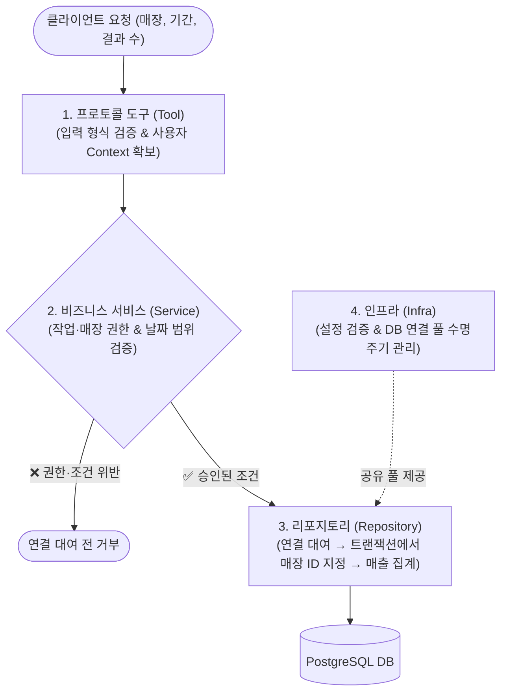

# MCP 서버 구현

매장 관리자가 지난달 매출이 가장 높은 상품을 알고 싶어 합니다. MCP 도구는 조회할 매장과 기간을 받고, 서비스(Service)는 사용자의 권한과 조회 조건을 확인합니다. 데이터 접근 계층은 승인된 조건에 따라 PostgreSQL에서 상품별 거래 금액을 합산합니다. 이 요청을 구현하면서 각 계층이 어떤 판단을 내리고 어떤 정보를 전달하는지 살펴봅니다.

실습 01에서 정한 계층별 책임을 바탕으로 실습 04에서 만든 데이터베이스를 MCP 서버에 연결합니다. 첫 업무 도구로 매출 상위 상품 조회를 선택한 이유는 소개 문서에 나온 사용자 요청을 구현하면서 주문·주문 상세·상품의 관계를 활용할 수 있기 때문입니다. 먼저 매출 조회의 서비스와 데이터 접근 기능을 구현하고, 이어서 MCP 도구로 연결하여 클라이언트에서 확인합니다. [소개 문서](../00-Introduction/README.md) · [실습 01](../01-Architecture/README.md) · [실습 04](../04-Database/README.md)

공식 `mcp` Python SDK와 Streamable HTTP를 사용하며, 서버에 미리 설정한 개발용 사용자 정보와 접근 권한으로 인가를 구현합니다. 접근 권한 판단의 대상이 되는 사용자나 서비스를 **보안 주체(Principal)**라고 합니다. 이번 실습의 개발용 사용자 정보는 이 주체를 나타내며, 실제 인증 결과는 아닙니다. 서버는 로컬 개발 환경에서 실행하고, 실제 사용자의 신원을 확인하는 OAuth 연동은 별도 실습으로 분리합니다.

## 학습 목표

이 실습을 마치면 다음을 할 수 있습니다.

- 권한 판단·SQL 실행·자원 정리가 어느 구성 요소의 책임인지 설명하고, 구현의 책임 분리가 적절한지 판단할 수 있습니다.
- 필수 설정을 시작 단계에서 검증하고, 관리 계정과 분리된 서비스 계정으로 조회해야 하는 이유를 설명할 수 있습니다.
- 서버가 공유하는 커넥션 풀(Connection Pool)과 작업별 연결·트랜잭션(Transaction)의 수명을 구분하고, 자원을 획득·반환할 위치를 판단할 수 있습니다.
- 작업·매장 권한 판단과 RLS의 역할을 구분하고, 승인한 매장 ID를 같은 연결의 트랜잭션 안에서 전달해야 하는 이유를 설명할 수 있습니다.
- MCP 도구 호출이 입력 확인·권한 판단·DB 조회·응답으로 이어지는 흐름을 추적하고, SDK와 업무 코드의 책임을 구분할 수 있습니다.
- 정상 응답만으로 자원 관리가 올바르다고 판단할 수 없는 이유를 설명하고, 시작 실패와 요청 오류·취소, 정상 종료에서 자원 정리를 확인할 근거를 선택할 수 있습니다.

## 1. 서버 구성 요소의 책임 나누기

### 목표

MCP 도구가 업무 기능을 제공할 때 프로토콜, 서비스, 데이터 접근, 인프라가 각각 맡을 일과 계층 사이에 전달할 정보를 정합니다.

### 개념과 구현 판단

도구는 클라이언트가 호출할 수 있는 업무 기능입니다. 예를 들어 매출 상위 상품 도구는 매장과 기간을 받아 상품 순위를 제공합니다. 이 기능을 수행하려면 사용자의 매출 조회 권한과 매장 접근 권한을 판단하고, 승인된 조건으로 매출을 집계해야 합니다. 서비스는 업무 판단과 처리 순서를 맡고, 데이터 접근 계층은 조회와 DB 자원 관리를 맡습니다.

| 구성 요소 | 담당하는 일 | 경계에서 주고받는 정보 |
| :--- | :--- | :--- |
| 프로토콜 계층의 도구(Tool) | 도구를 등록하고 입력 형식을 검증하며 결과와 오류를 MCP 응답으로 구성 | 검증한 입력과 서버가 제공한 사용자 정보를 서비스에 전달 |
| 비즈니스 서비스(Service) | 작업·매장 권한과 업무 규칙을 판단하고 필요한 조회를 요청 | 승인된 매장과 조회 조건을 데이터 접근 계층에 전달 |
| 데이터 접근 계층의 리포지토리(Repository) | SQL과 파라미터 바인딩, 연결 대여와 반환, 트랜잭션, 매장 ID 설정을 관리 | 집계 결과처럼 서비스에서 사용할 업무 값을 반환 |
| 인프라 | 설정을 검증하고 서버의 시작·종료에 맞춰 풀과 서비스에 필요한 구성 요소를 준비 | 데이터 접근 코드에 공유 풀과 관련 설정을 전달하고, 도구가 사용할 서비스를 구성 |

요청을 처리하는 동안 도구는 준비된 서비스를 호출합니다. 서비스는 승인된 조건으로 데이터 접근 기능을 호출하고, 데이터 접근 계층은 필요한 동안만 연결을 빌립니다. 이 흐름에서 어떤 도구를 추가하더라도 인가의 위치와 연결의 정리 책임을 확인할 수 있어야 합니다. 5번에서는 이 구분을 매출 상위 상품 조회에 적용하여 구체적인 입력과 결과를 정합니다.

### 진행할 작업

1. 현재 프로젝트에서 도구 등록, 업무 판단, DB 조회, 시작·종료를 담당할 코드의 위치를 정합니다.
2. 클라이언트의 요청이 도구에서 서비스와 데이터 접근 계층으로 전달되고, 업무 결과가 다시 응답으로 돌아오는 흐름을 정리합니다.
3. 서버가 제공하는 사용자 정보와 클라이언트의 조회 조건을 구분하고, 권한이 없을 때 어느 계층에서 요청을 끝낼지 정합니다.
4. 서버 시작 시 누가 풀과 조회 기능을 연결하고, 각 요청에서 누가 연결과 트랜잭션을 관리할지 정합니다.

### 완료 기준

- 계획한 코드 구조에서 도구의 입출력, 서비스의 업무 판단, 데이터 접근 계층의 SQL과 연결 관리, 인프라의 시작·종료 책임을 각각 찾을 수 있습니다.
- 도구는 업무 입력과 사용자 정보로 서비스를 호출하고, 서비스는 승인된 조회 조건만 데이터 접근 계층에 전달하도록 흐름이 정의되어 있습니다.
- 권한이 없는 요청을 연결 대여 전에 거부하고, 조회를 마친 뒤에는 업무 결과만 상위 계층으로 전달하도록 계획했습니다.
- 서버 시작 시 구성할 의존성과 작업마다 대여할 자원이 구분되어 있으며, 다음 단계에서 사용할 파일 구성과 연결 방식이 정해져 있습니다.

## 2. 서버 설정 준비하기

### 목표

서버가 사용할 설정값을 읽고 자료형과 조건을 검사한 뒤, 다른 구성 요소에 전달하는 기능을 구현합니다.

### 개념과 구현 판단

서버가 DB에 연결하려면 접속 주소·포트·계정·비밀번호가 필요합니다. 이 값은 실행 환경에 따라 달라지므로 주문 조회 코드에 직접 넣지 않고 외부 설정에서 읽습니다. 이번 단계에서는 설정을 읽고 검사하는 코드를 구현하여, 서버 실행 코드와 DB 연결 코드가 사용할 값으로 제공합니다.

기존 DB 접속 정보는 `.env.reader`를 사용합니다. `uv`의 `--env-file` 옵션으로 이 파일의 값을 실행 환경에 불러오고, Python 코드는 환경변수에서 값을 읽습니다. 파일을 실행 환경에 불러오는 일과 읽은 값을 프로그램에 맞게 해석하는 일을 구분합니다. [uv 환경 파일 옵션](https://docs.astral.sh/uv/reference/cli/#uv-run--env-file)을 참고합니다.

설정 처리 흐름은 **값 읽기 → 자료형 변환 → 조건 검사 → 검증한 설정 반환**입니다. 예를 들어 환경변수의 포트 값 `5432`는 문자열로 읽힙니다. 이를 정수로 바꾼 뒤 포트 범위인 1~65,535 안에 있는지 검사합니다. `abc`처럼 정수로 바꿀 수 없는 값과 `70000`처럼 범위를 벗어난 값은 각각 이유를 알 수 있는 설정 오류가 되어야 합니다. [Python 환경변수 설명](https://docs.python.org/3.12/library/os.html#os.environ)에서 읽은 값의 자료형을 확인할 수 있습니다.

설정을 읽기 전에 항목별 출처, 필수 여부, 기본값 사용 여부, 자료형과 검사 조건을 정합니다. 기존 DB 접속 정보는 재사용하고, 이번 서버에 추가로 필요한 설정만 같은 기준으로 정리합니다.

| 설정 | 정할 규칙 |
| :--- | :--- |
| DB 접속 | 서비스 계정의 기존 환경변수를 읽고, 필수 값 누락·빈 값과 포트의 자료형·범위를 검사 |
| 서버 실행 | 로컬 접속 주소·포트·MCP 경로의 출처와 형식, 생략할 때 사용할 기본값의 유무를 명시 |
| 자원 사용 | 풀의 최소·최대 연결 수와 대기 시간 제한의 기본값·허용 범위, 최소·최대 값의 관계를 명시 |
| 개발용 사용자·권한 | 서버가 관리하는 사용자 식별자·허용 작업·허용 매장의 출처와 형식, 누락·빈 목록의 처리 기준을 명시 |

기본값은 생략했을 때 사용할 값으로 정한 항목에만 적용합니다. 포트에 `abc`를 입력했는데 기본 포트로 바꾸면 잘못된 설정을 발견하지 못합니다. 풀의 최소 연결 수가 최대 연결 수보다 큰 경우처럼, 각 값의 형식은 맞아도 함께 사용할 수 없는 조합도 검사해야 합니다. 구체적인 풀 크기와 시간 제한은 로컬 실행 환경에 맞춰 선택하고, 기본값과 검사 조건을 기록합니다.

개발용 사용자·권한 정보는 서버가 관리하는 설정이나 데이터에서 읽도록 구성합니다. 모든 항목을 환경변수로 만들 필요는 없습니다. 사용자 정보가 누락되었거나 권한 목록을 해석할 수 없다면 설정 오류로 처리합니다. 반면 명시적으로 빈 허용 목록을 지정했다면 부여한 권한이 없는 상태로 유지합니다. 누락이나 빈 목록을 전체 매장 접근으로 바꾸지 않습니다. 요청별 작업·매장 허용 여부를 판단하는 코드는 5번에서 이 정보를 사용합니다.

검증한 값은 다른 구성 요소가 사용할 수 있는 자료구조로 묶어 반환합니다. 예를 들어 DB 연결 코드에는 정수로 변환된 포트를 전달하여, 그 코드가 환경변수를 다시 읽고 같은 검사를 반복하지 않도록 합니다. 설정 로딩과 검증은 서버 구성 시 수행하고, 요청 처리에서는 전달받은 설정을 사용합니다.

이 단계의 검증은 설정값의 존재·형식·조건에 대한 검사입니다. 비밀번호가 입력되어 있어도 실제 비밀번호가 틀릴 수 있고, 계정 이름을 읽었다고 DB 권한이 확인된 것도 아닙니다. 실제 접속과 DB 접근 가능 여부는 4번의 풀 초기화에서 확인합니다. 여기서는 설정 로딩 기능을 직접 실행하여 정상 입력과 오류 처리를 확인합니다.

### 진행할 작업

1. 1번에서 정한 파일 구성에 따라 설정을 읽고 반환할 기능을 구현합니다. 항목별 출처·필수 여부·기본값·자료형·검사 조건을 정하고 코드에 반영합니다.
2. 기존 서비스 계정의 DB 접속 설정을 읽고, 포트·연결 수·시간 제한처럼 변환이 필요한 값을 해당 자료형으로 바꿉니다. 개발용 사용자·권한 정보는 정한 출처와 형식으로 읽습니다.
3. 필수 값 누락, 자료형 변환 실패, 범위 위반, 설정 간 모순을 검사합니다. 기본값은 허용한 생략 항목에만 사용하고, 관리자 계정이나 전체 매장 권한으로 대체하지 않습니다.
4. 검증한 값을 서버와 DB 연결 코드가 재사용할 형태로 반환합니다. 추가한 설정 항목과 기본값은 비밀값 없는 예시와 실행 안내에 기록합니다.
5. 설정 로딩 기능을 직접 실행하여 정상 설정의 반환값과 누락·잘못된 자료형·범위 위반·최소·최대 관계 오류를 확인합니다. 권한 정보의 누락과 명시적인 빈 목록도 구분하여 확인합니다.
6. 오류가 난 항목과 이유를 알 수 있도록 처리하고, 비밀번호·전체 접속 문자열과 같은 비밀값이 출력되지 않는지 확인합니다.

### 완료 기준

설정 로딩 기능만 실행하여 다음을 확인할 수 있습니다.

- 정상 설정은 필요한 자료형으로 변환되어 반환되고, 다른 구성 요소는 이 값을 전달받아 사용할 수 있습니다.
- 필수 값 누락·잘못된 자료형·범위 위반·설정 간 모순은 해당 항목과 이유를 식별할 수 있는 오류로 처리됩니다.
- 기본값이 있는 항목의 생략과 잘못된 값의 입력을 구분하며, 오류를 관리자 계정이나 전체 매장 권한으로 덮지 않습니다.
- 개발용 권한 목록이 명시적으로 비어 있으면 권한 없는 상태를 유지하고, 누락이나 해석 오류와 구분합니다.
- 정상 처리와 오류 처리 모두에서 비밀번호가 노출되지 않습니다.

## 3. MCP 서버 실행하기

### 목표

검증된 설정값으로 로컬 MCP 서버를 실행하고, SDK 클라이언트가 HTTP를 통해 도구 목록을 조회할 수 있도록 구현합니다.

### 개념과 구현 판단

이번 단계의 처리 흐름은 **설정 읽기 → 서버 구성·실행 → 클라이언트의 HTTP 요청 → 도구 목록 응답**입니다. 2번에서 구현한 설정 기능으로 값을 읽고 검증한 뒤, 서버 실행에 필요한 주소·포트·MCP 경로를 전달합니다. 설정 검증에 실패하면 요청을 받기 전에 실행을 중단하여, 잘못된 설정으로 서버가 동작하지 않도록 합니다.

`mcp==2.3.0`의 고수준 서버 API인 `MCPServer`를 사용합니다. **서버 객체**는 도구와 서버 동작을 SDK를 통해 구성하는 객체입니다. **실행 진입점**은 설정을 읽고 이 객체를 구성한 뒤 서버 실행을 시작하는 코드입니다. 서버 객체를 생성하는 것만으로 HTTP 요청을 받는 것은 아니며, Streamable HTTP 방식으로 실행해야 클라이언트가 접속할 수 있습니다. 메시지 형식과 프로토콜 처리는 SDK가 담당하고, 애플리케이션 코드는 설정과 서버 실행을 연결합니다. [Python SDK 공식 문서](https://py.sdk.modelcontextprotocol.io/get-started/first-steps/)에서 서버 구성과 클라이언트 접속 방식을 확인할 수 있습니다.

**엔드포인트(Endpoint)**는 클라이언트가 MCP 요청을 보내는 주소입니다. 예를 들어 `http://127.0.0.1:8000/mcp`에서 `127.0.0.1`은 접속 주소, `8000`은 포트, `/mcp`는 MCP 요청을 받을 경로입니다. 이 값은 예시이며, 실제 클라이언트에는 서버가 실행 중인 주소·포트·경로에 맞는 URL을 지정합니다. 서버는 이 엔드포인트에서 Streamable HTTP 요청을 처리하고, 클라이언트는 SDK를 통해 요청을 보내고 응답을 읽습니다.

서버는 `127.0.0.1`에 바인딩하여 같은 컴퓨터에서 접속하도록 수신 범위를 제한합니다. 이 설정과 HTTP 헤더 검사는 역할이 다릅니다. `Host` 헤더는 요청이 대상으로 삼은 서버 주소를 나타내고, 브라우저 요청의 `Origin` 헤더는 요청이 시작된 출처를 나타냅니다. 로컬 서버에도 악성 웹사이트에서 접근을 시도할 수 있으므로, SDK의 Host·Origin 검사 설정을 확인하고 로컬 실행에 필요한 주소와 출처만 허용합니다. Origin 헤더가 있는 요청은 허용된 출처인지 검사하며, 접속 문제를 해결하려고 검사를 끄거나 모든 출처를 허용하지 않습니다. [Streamable HTTP 공식 명세](https://modelcontextprotocol.io/specification/2026-07-28/basic/transports/streamable-http)는 로컬 바인딩 제한과 Origin 검증의 필요성을 설명합니다.

통신 확인에는 SDK 클라이언트의 도구 목록 조회인 `list_tools()`를 사용합니다. 도구를 등록하지 않은 현재 상태에서는 빈 목록이 정상 결과입니다. 이를 통해 클라이언트의 HTTP 요청이 서버에 정상 도달하여 MCP 응답이 반환되는지 확인합니다. 포트가 열려 있거나 일반 HTTP 응답을 받았다는 사실만으로는 이 처리 과정이 확인되지 않습니다. Python 함수를 직접 호출하거나 서버 객체를 클라이언트에 직접 전달하는 확인도 HTTP 통신을 거치지 않으므로, 여기서는 실제 URL로 접속합니다.

서버 실행에는 시작부터 종료까지의 수명주기도 있습니다. SDK의 수명주기(Lifespan) 기능은 서버가 요청을 처리하기 전에 공유 자원을 준비하고 종료할 때 정리하는 코드를 연결하는 기능입니다. 서버 전체에서 사용할 자원을 각 요청 안에서 반복해서 준비하지 않도록, 서버의 시작·종료와 요청 처리의 역할을 구분합니다. [SDK 수명주기 설명](https://py.sdk.modelcontextprotocol.io/handlers/lifespan/)을 참고합니다.

### 진행할 작업

1. 1번에서 정한 파일 구성에 따라 서버 구성·실행 코드를 구현하고, 2번의 설정 기능을 연결합니다. 설정 검증을 통과한 값을 서버 실행에 전달합니다.
2. 공식 SDK의 `MCPServer`로 서버를 구성하고, 검증된 주소·포트·MCP 경로를 사용하여 Streamable HTTP로 실행합니다.
3. 서버를 `127.0.0.1`에 바인딩하고, SDK의 Host·Origin 검사 설정을 로컬 실행에 필요한 허용 범위로 구성합니다.
4. 별도로 실행한 SDK 클라이언트가 실제 HTTP URL에 접속하여 `list_tools()`를 호출하도록 구성하고, 빈 도구 목록이 정상 응답으로 반환되는지 확인합니다.
5. 프로젝트의 실행 안내에 서버 실행 명령, 클라이언트의 접속 URL과 확인 방법, 예상 결과를 정리합니다. 환경 파일이 필요한 명령은 기존 `.env.reader`를 사용하고, `uv`로 Python을 실행할 때는 `--locked`를 적용합니다.

### 완료 기준

구현한 서버와 SDK 클라이언트를 실행하여 다음을 확인할 수 있습니다.

- 서버는 2번의 설정 기능을 거쳐 지정한 로컬 주소·포트·MCP 경로에서 실행됩니다. 설정 검증에 실패하면 HTTP 요청을 받기 전에 실행이 중단됩니다.
- 별도로 실행한 SDK 클라이언트가 실제 HTTP URL로 도구 목록을 요청하고, 오류 없이 빈 목록을 받습니다.
- 서버의 로컬 바인딩과 Host·Origin 검사 설정이 적용되어 있으며, 검사를 비활성화하거나 모든 출처를 허용하지 않습니다.
- 정리한 서버 실행 명령과 클라이언트 확인 방법으로 같은 결과를 다시 확인할 수 있습니다.

## 4. DB 연결 풀 관리하기

### 목표

검증된 설정으로 DB 연결 풀을 생성하고, 서비스 계정의 DB 사용 준비를 확인한 뒤, 서버 시작 실패와 정상 종료에서 풀을 정리하도록 구현합니다.

### 개념과 구현 판단

DB 연결을 새로 만들 때는 접속과 인증이 필요합니다. **연결 풀(Connection Pool)**은 DB 연결을 관리하고, 작업에 필요한 연결을 빌려줍니다. 작업 A가 연결을 사용한 뒤 풀에 반환하면 작업 B가 그 연결을 다시 빌릴 수 있습니다. 여기서 반환은 커넥션 사용을 마치고 풀에 돌려주는 동작을 의미하며, 매번 DB 접속을 끊는다는 뜻이 아닙니다. 서버가 풀을 종료할 때는 풀에서 관리하는 실제 연결도 닫습니다. [asyncpg 연결 풀 문서](https://magicstack.github.io/asyncpg/current/api/index.html#connection-pools)를 참고합니다.

풀과 빌린 연결은 유효한 기간이 다릅니다. 이번에는 서버 실행 동안 공유할 풀 하나를 만들고, 데이터 접근 코드가 그 풀에서 필요한 동안만 연결을 빌리도록 합니다. 조회 결과를 응답으로 바꾸는 동안까지 연결을 붙잡고 있으면 다른 작업이 더 오래 기다릴 수 있습니다. 요청마다 풀을 새로 만드는 경우에도 연결 재사용의 이점을 얻기 어렵고, 서버 전체의 연결 수를 제한하기 어려워집니다. 풀의 생성·종료는 인프라 계층이 담당하고, 전달받은 풀에서 연결을 빌리고 반환하는 일은 데이터 접근 계층이 담당하도록 구성합니다.

풀 크기는 동시에 사용할 수 있는 DB 연결 수와 관계가 있습니다. 최대 연결 수가 2이고 두 연결이 모두 사용 중이라면, 다음 작업은 연결이 반환되기를 기다립니다. 연결 수를 제한하더라도 기다리는 시간이 자동으로 제한되는 것은 아닙니다. 2번에서 검증한 설정값을 다음과 같이 서로 다른 동작에 적용합니다.

| 설정 | 제한하는 대상 |
| :--- | :--- |
| 최대 연결 수 | 풀이 관리할 DB 연결 수의 상한 |
| 연결 생성 시간 제한 | DB에 새로 접속하는 데 걸리는 시간 |
| 연결 대여 시간 제한 | 풀에서 사용할 연결을 얻기까지 기다리는 시간 |
| 쿼리 시간 제한 | DB 명령 실행을 기다리는 시간 |
| 풀 종료 시간 제한 | 사용 중인 연결의 반환과 풀 종료를 기다리는 시간 |

예를 들어 쿼리 시간 제한을 설정했더라도, 연결을 얻지 못해 기다리는 작업의 대여 시간까지 제한되지는 않습니다. 에이전트가 제안한 설정은 값의 크기뿐 아니라 어느 동작에 적용되는지도 검토합니다.

서버의 처리 흐름은 **서버 시작 → 풀 생성 → DB 사용 준비 확인 → 요청 처리 → 종료 시 풀 정리**입니다. SDK의 수명주기(Lifespan) 기능에 시작·종료 코드를 연결하고, 2번에서 검증한 서비스 계정의 접속 정보와 풀 설정을 사용합니다. SDK는 이 코드를 실행할 위치를 제공하며, 생성한 풀의 정리는 애플리케이션이 구현해야 합니다. 풀을 생성한 뒤 테이블 접근 확인에서 실패한 경우처럼 요청 처리를 시작하지 못했더라도, 이미 생성한 풀은 정리해야 합니다. [SDK 수명주기 설명](https://py.sdk.modelcontextprotocol.io/handlers/lifespan/)을 참고합니다.

시작할 때는 풀에서 실제 연결을 빌려 접속 계정을 확인하고, 서버가 사용할 테이블에 필요한 조회를 실행할 수 있는지 확인합니다. 연결 확인용 쿼리가 성공해도 업무 테이블의 존재나 조회 권한까지 확인되는 것은 아니므로, 필요한 테이블에 개인정보를 출력하지 않는 제한된 조회를 실행합니다. RLS가 적용된 테이블은 매장 ID를 설정하지 않으면 결과가 비어 있을 수 있습니다. **조회가 실행되는지와 결과 행이 존재하는지를 구분**하여, 빈 결과 자체를 시작 실패로 판단하지 않습니다. 이 확인은 DB 사용 준비에 대한 검사이며, 매장별 권한과 데이터 격리의 정확성을 입증하는 검사는 아닙니다. 확인에 사용한 연결은 성공·실패 모두에서 반환하고, 서버 실행 중에는 계정·테이블·RLS 정책을 생성하거나 변경하지 않습니다.

서버 종료 경로에서는 풀 종료가 완료될 때까지 기다립니다. `asyncpg`의 정상적인 풀 종료는 빌려준 연결의 반환을 기다린 뒤 연결을 닫으므로, 반환되지 않은 연결이 있으면 종료도 지연될 수 있습니다. 종료에는 시간 제한을 적용하고, 이를 넘기면 드라이버의 강제 종료 기능으로 정리하도록 구성합니다. 정상 종료는 사용 중인 연결의 반환을 기다려 닫는 것이고, 강제 종료는 그 반환을 더 기다리지 않고 연결을 끊는 것입니다. 두 결과를 구분해 기록하며, 종료 로그를 남겼다는 사실만으로 정리가 끝났다고 판단하지 않습니다. [asyncpg 풀 종료 설명](https://magicstack.github.io/asyncpg/current/api/index.html#asyncpg.pool.Pool.close)을 참고합니다.

### 진행할 작업

1. 2번에서 검증한 서비스 계정의 DB 접속 정보와 풀 설정으로 `asyncpg` 풀을 생성하고, SDK 수명주기에 초기화를 연결합니다.
2. 풀에서 연결을 빌려 실제 접속 계정과 필요한 테이블의 조회 가능 여부를 확인합니다. 개인정보 원문을 출력하지 않고, 결과가 비어 있어도 조회 실행의 성공 여부를 판단할 수 있도록 구성합니다.
3. 준비 확인에 사용한 연결을 성공·실패 모두에서 반환하고, 준비 확인을 통과한 뒤 요청 처리를 시작하도록 구성합니다.
4. 수명주기에서 생성한 풀을 데이터 접근 코드에 전달하여 같은 풀을 사용할 수 있도록 연결합니다. 모듈을 불러오거나 요청을 처리할 때마다 풀을 생성하지 않습니다.
5. 풀 생성 이후 준비 실패와 정상 종료에서 생성한 풀을 정리합니다. 연결 생성·대여, 쿼리 실행과 풀 종료에 각각 필요한 시간 제한을 적용하고, 종료 시간 초과 시 정리 방식도 정합니다.
6. 정상 시작, DB 접속 실패, 풀 생성 이후 준비 확인 실패, 정상 종료를 확인합니다. 종료 시간 제한에 도달하는 경우의 처리도 확인하고, 각 상황에서 생성한 자원이 정리되는지 검토합니다.
7. 시작·실패·종료를 확인한 방법과 결과를 기록합니다. 정상 종료와 강제 정리를 구분하고, 비밀번호·전체 접속 문자열·고객 개인정보가 로그에 노출되지 않도록 합니다.

### 완료 기준

서버의 시작·종료와 준비 확인을 실행하여 다음을 확인할 수 있습니다.

- 정상 시작에서는 검증한 설정으로 풀을 생성하고, 서비스 계정의 접속과 필요한 테이블의 조회 가능 여부를 확인한 뒤 요청 처리를 시작합니다.
- 준비 확인에 빌린 연결은 성공·실패 모두에서 반환됩니다. 빈 조회 결과를 접근 실패로 잘못 판단하지 않습니다.
- 인프라 계층이 생성한 풀을 데이터 접근 코드가 전달받을 수 있고, 요청마다 새 풀을 생성하지 않는 구조로 연결되어 있습니다.
- DB 접속이나 테이블 접근 확인이 실패하면 요청 처리 단계로 진행하지 않습니다. 풀 생성 이후의 준비 실패에서도 생성한 풀을 정리합니다.
- 정상 종료에서 풀 종료의 완료를 확인할 수 있습니다. 종료 시간 제한에 도달하면 정해진 방식으로 강제 정리를 수행하고, 정상 종료와 구분하여 결과를 기록합니다.
- 확인한 방법과 결과로 준비 성공·실패와 자원 정리 여부를 판단할 수 있으며, 그 기록에 비밀값이나 고객 개인정보가 포함되지 않습니다.

## 5. 매장별 매출 상위 상품 조회 구현하기

### 목표

매출 조회 권한과 조회 조건을 확인하는 서비스와, 승인된 매장의 상품별 매출을 집계하는 데이터 접근 기능을 구현합니다. 서버 시작 시 두 기능을 연결하여 내부 호출로 확인합니다.

### 조회 기준 정하기

매출 상위 상품 도구는 매장 ID, 시작일, 종료일, 결과 수를 받습니다. 시작일과 종료일을 모두 포함하여 해당 기간에 주문된 상품의 거래 금액을 집계합니다. 상품마다 `order_items.total_amount`를 합산하고, 합계가 큰 순서대로 요청한 수만큼 반환합니다. 결과 항목에는 상품 ID, 상품명, 집계 금액을 담습니다. 금액은 합산과 결과 전달 과정에서 원래 정밀도를 유지합니다. [실습 04의 주문과 주문 상세 설명](../04-Database/README.md#주문과-주문-상세-나누기)

매출이 같은 상품에 적용할 정렬 기준을 정합니다. 예를 들어 상품 ID 오름차순을 두 번째 기준으로 삼으면 같은 입력과 데이터에서 순위가 일정합니다. 기간에 해당하는 주문 상세가 없으면 빈 목록을 반환합니다. 에이전트가 날짜의 허용 범위와 결과 수의 상한을 제안하면, 학습자는 그 기준이 이 도구의 업무 목적에 맞는지 확인합니다.

### Service에서 권한과 조회 조건 판단하기

서비스는 2번에서 준비한 개발용 사용자 정보와 조회 조건을 받습니다. 먼저 서버가 부여한 매출 조회 권한과 요청한 매장에 대한 접근 권한을 확인합니다. 이어서 시작일이 종료일보다 늦거나 결과 수가 허용 범위를 벗어난 요청을 거부합니다. 이 판단을 마친 뒤 승인된 매장과 조회 조건으로 데이터 접근 기능을 호출합니다.

`sales:read`는 매출 보고서를 열람할 수 있는 업무 권한입니다. 매출 상위 상품 조회에서 이 권한을 처음 사용합니다. 서비스는 서버가 제공한 `allowed_actions`에 `sales:read`가 있는지, `allowed_store_ids`에 조회할 매장이 포함되는지 확인합니다. 작업·매장 권한을 대조하는 규칙은 다른 매장별 조회에도 적용할 수 있습니다. 기간과 결과 수의 업무 규칙은 매출 상위 상품 조회의 요구에 맞춰 정합니다.

### 데이터 접근 계층(Repository)에서 집계하기

데이터 접근 계층은 4번에서 준비한 풀에서 연결을 하나 빌립니다. 같은 연결의 트랜잭션을 시작하고 `set_config`의 세 번째 인자를 `true`로 지정해 승인된 매장 ID를 `app.current_store_id`에 적용합니다. 매장 ID는 문자열로 바꿔 SQL 파라미터로 전달합니다. 트랜잭션이 끝나면 이번 설정의 효력도 끝나므로, 다음 작업은 자신의 매장 ID를 적용할 수 있습니다. [PostgreSQL 설정 함수](https://www.postgresql.org/docs/18/functions-admin.html#FUNCTIONS-ADMIN-SET)

집계에서는 `orders.order_date`로 조회 기간을 적용합니다. `orders`와 `order_items`는 주문 ID와 매장 ID로 연결하고, `order_items`와 `products`는 상품 ID로 연결합니다. 상품을 ID로 구분해 거래 금액을 합산하고, 정한 정렬 기준과 결과 수를 적용합니다. 날짜와 결과 수 등 쿼리 입력값도 파라미터로 바인딩합니다.

연결을 빌린 범위 안에 트랜잭션 범위를 둡니다. 조회를 마치면 트랜잭션을 종료하고 연결을 반환한 뒤 상품별 집계 결과를 전달합니다. 쿼리 오류·시간 초과·취소 때도 해당 종료 경로에서 자원을 정리하고 실패나 취소를 상위 계층에 전달합니다. 연결 대여부터 트랜잭션 범위의 매장 ID 적용과 반환까지는 매장별 조회에서 공통으로 지킬 규칙입니다. 상품별 금액 합산과 순위는 이 조회에 고유한 작업입니다. [asyncpg 트랜잭션과 연결 풀 사용법](https://magicstack.github.io/asyncpg/current/usage.html#transactions)

### 진행할 작업

1. 매출의 집계 기준, 기간 경계, 동률 정렬, 결과 수의 허용 범위와 반환 필드를 정합니다. 어떤 거래가 합계에 포함되는지 설명할 수 있는 조회 사례를 고릅니다.
2. 서버가 설정에서 허용하는 작업 권한에 `sales:read`를 등록합니다. 개발용 사용자 예시를 갱신하고, 실습용 사용자의 `allowed_actions`와 `allowed_store_ids`에 필요한 권한을 명시합니다. 서버가 이 설정을 읽고 검증할 수 있는지 확인합니다.
3. 서비스에서 작업·매장 권한과 기간·결과 수의 업무 규칙을 검사하고, 승인된 조건을 데이터 접근 계층에 전달합니다.
4. 데이터 접근 계층에서 매장 ID 설정과 집계를 같은 연결의 트랜잭션으로 묶습니다. 정상 완료와 오류·시간 초과·취소 시 연결이 정리되는 경로를 구현합니다.
5. 서버 시작 시 데이터 접근 기능에 공유 풀을 연결하고, 해당 조회 기능을 사용하는 서비스를 준비합니다. 6번의 도구는 이 서비스를 사용합니다.
6. 준비한 서비스를 내부에서 호출합니다. 제공 CSV의 해당 매장·기간 거래에서 독립적으로 구한 기대값과 집계 결과를 대조합니다. `sales:read`와 대상 매장 권한이 모두 있는 경우, `orders:count`만 있는 경우, `sales:read`는 있지만 대상 매장 권한이 없는 경우를 각각 확인합니다. 권한 거부와 잘못된 조회 조건은 연결 대여 전에 처리되는지 확인합니다.
7. 같은 연결에서 트랜잭션 중의 매장 ID를 확인합니다. 트랜잭션 종료 직후 연결을 풀에 반환하기 전에 이번 설정의 효력이 끝났는지 확인합니다. 연결을 재사용하는 검사는 별도로 진행하고, 서로 다른 매장을 차례로 조회하여 각 결과를 해당 매장의 기대값과 대조합니다.
8. 연결을 사용 중인 상황에서 DB 오류·시간 초과·취소가 발생하는 경로를 검증합니다. 트랜잭션과 연결이 정리되는지 확인하고, 후속 조회가 정상적으로 처리되는지 확인합니다.

### 완료 기준

- 매장과 기간에 어떤 거래가 포함되는지, 상품별 금액과 순위가 어떻게 결정되는지 설명할 수 있습니다.
- 서버에서 구성한 서비스를 내부에서 호출하면 허용된 매장의 상품 순위와 집계 금액이 기대값과 일치합니다. 결과 수 제한, 동률 정렬, 거래가 없는 기간의 빈 결과도 정한 기준에 맞습니다.
- 검증한 사용자 설정의 `sales:read`와 대상 매장 권한이 모두 있으면 조회할 수 있습니다. `orders:count`만 있거나 대상 매장 권한이 없는 요청, 기간·결과 수가 업무 규칙에 어긋나는 요청은 연결을 빌리기 전에 거부됩니다.
- 허용된 조회의 매장 ID 설정과 집계가 같은 연결의 트랜잭션에서 실행됩니다. 트랜잭션 범위가 끝날 때 해당 설정의 효력이 끝나며, 연결을 재사용해 다른 매장을 조회할 때 결과가 섞이지 않습니다.
- 조회가 끝나면 데이터 접근 계층이 연결을 반환하고 집계 결과를 전달합니다. 오류·시간 초과·취소에서도 필요한 정리가 이루어지며, 실패와 정상적인 빈 결과를 구분할 수 있습니다.

## 6. 매출 상위 상품 조회를 MCP 도구로 연결하기

### 목표

5번에서 준비한 서비스를 호출하는 MCP 도구를 등록합니다. SDK 클라이언트가 실제 HTTP로 도구를 발견하고 호출하여 상품 순위, 집계 금액, 실패 여부를 확인할 수 있도록 구현합니다.

### 개념과 구현 판단

도구를 등록하면 클라이언트는 도구 목록에서 이름, 설명, 입력과 출력의 형식을 확인할 수 있습니다. 입출력 스키마(Schema)는 각 필드의 자료형과 필수 여부 같은 규칙을 나타냅니다. 설명에는 어떤 매장과 기간을 받는지, 순위가 무엇을 기준으로 정해지는지 적습니다. [MCP Python SDK 도구 문서](https://py.sdk.modelcontextprotocol.io/servers/tools/)

도구는 매장 ID와 결과 수가 정수인지, 날짜가 지정한 형식에 맞는지 검증합니다. 이어서 검증한 입력과 서버가 제공하는 사용자 정보를 준비된 서비스에 전달합니다. 날짜가 올바른 형식이어도 시작일이 종료일보다 늦을 수 있습니다. 이런 조건은 매출 조회의 업무 규칙이므로 5번의 서비스가 권한과 함께 판단합니다.

서비스가 반환한 상품 목록을 **구조화된 출력(Structured Output)**으로 제공합니다. 조회한 매장과 기간을 포함하면 클라이언트가 어떤 조건에서 산출된 집계인지 명확히 확인할 수 있습니다. 출력 스키마에는 상품 ID·상품명·집계 금액의 필드와 자료형을 명시하고, 금액이 어떤 형식으로 전달되는지 정합니다. 예를 들어 금액을 십진 문자열로 표현한다면 클라이언트가 해당 필드를 정확한 금액으로 해석할 수 있도록 그 규칙을 설명합니다. [MCP Python SDK 구조화된 출력 문서](https://py.sdk.modelcontextprotocol.io/servers/structured-output/)

거래가 없는 경우는 상품 목록이 비어 있는 성공 결과입니다. 권한 거부와 DB 실패는 각각 의미에 맞는 안전한 오류로 전달합니다. 클라이언트는 HTTP 응답을 받은 뒤 SDK의 오류 표시나 예외를 확인하여 도구 실행 결과를 판단합니다. 요청이 취소되면 취소가 내부 조회까지 전달되어 5번에서 구현한 정리 경로가 실행되도록 연결합니다. [MCP Python SDK 오류 처리 문서](https://py.sdk.modelcontextprotocol.io/servers/handling-errors/)

### 진행할 작업

1. 매출 상위 상품 도구의 이름·설명·입출력 스키마를 정하고 공식 SDK에 등록합니다. 반환값의 필드와 금액 표현을 클라이언트가 확인할 수 있게 합니다.
2. 도구의 입력 검증과 서버의 사용자 정보를 5번의 서비스 호출에 연결합니다. 성공 결과를 구조화된 출력으로 전달하고, 권한 거부와 조회 실패를 MCP 오류 처리 방식에 맞춰 표현합니다.
3. 별도로 실행한 SDK 클라이언트로 실제 Streamable HTTP 주소에 접속합니다. 도구 목록의 이름·설명·입출력 형식을 확인한 뒤, 5번의 검증 사례와 같은 매장·기간·결과 수로 호출합니다.
4. 입력 형식 오류, 권한 밖 매장, 업무 규칙 위반, DB 실패를 각각 확인합니다. 입력과 권한 검사에서 거부된 요청이 집계를 실행하기 전에 종료되는지 확인하고, 클라이언트의 성공 결과와 오류를 비교합니다.
5. 실제 HTTP 도구 호출이 DB 연결을 사용 중일 때 클라이언트에서 호출을 취소합니다. 취소가 내부 조회에 전달되어 트랜잭션과 연결이 정리되는지 확인하고, 이후 정상적인 HTTP 호출이 처리되는지 확인합니다.

### 완료 기준

- SDK 클라이언트가 실제 HTTP 주소의 도구 목록에서 매출 상위 상품 도구와 입출력 스키마를 확인할 수 있습니다. 호출에 사용하는 입력은 조회 조건이며, 사용자 정보와 허용 권한은 서버가 제공합니다.
- 허용된 호출은 요청한 매장과 기간의 상품 순위와 집계 금액을 구조화된 결과로 반환합니다. 클라이언트에서 읽은 값이 5번의 독립적인 기대값과 일치합니다.
- 형식이 잘못된 입력은 도구 경계에서 거부됩니다. 형식이 맞는 요청의 권한과 업무 규칙은 서비스에서 판단하고, 거부된 요청은 연결 대여로 이어지지 않습니다.
- 거래가 없는 정상 결과, 권한 거부, DB 실패를 클라이언트에서 구분할 수 있습니다. 오류 응답에는 클라이언트가 처리에 필요한 정보가 담기며, 비밀번호·접속 문자열·고객 개인정보는 응답에 포함되지 않습니다.
- DB 연결을 사용 중인 HTTP 요청을 취소하면 내부 조회에서 자원 정리가 이루어지고, 다음 정상 호출이 처리됩니다.
- 실행 방법과 검증에 사용한 입력·기대값을 확인할 수 있어, 다른 학습자가 동일한 데이터 조건에서 호출을 재현할 수 있습니다.

## 핵심 요약

- **책임의 분리**: 프로토콜 처리·권한 판단·DB 조회·공유 자원 관리의 책임을 나눕니다. 도구 함수는 내부 업무 기능을 연결하고, 비즈니스 로직과 데이터 접근 계층은 각각 권한 판단과 SQL 실행을 담당합니다.
- **설정 검증과 DB 사용 확인**: 설정의 존재·자료형·조건을 검사하는 것과 실제 DB에 접속하여 필요한 테이블을 조회할 수 있는지 확인하는 것은 별개입니다. 서버 조회에는 최소 권한의 서비스 계정을 사용하고, 시작 시 해당 계정으로 DB 사용 준비를 확인합니다.
- **자원별 수명과 정리 책임**: 서버는 풀을 공유하고, 각 작업은 필요한 범위에서 연결과 트랜잭션을 사용합니다. 서버 시작 실패·종료에서는 풀을 정리하고, 작업 완료·실패·취소에서는 트랜잭션을 종료하고 빌린 연결을 반환합니다.
- **인가와 RLS의 역할**: 애플리케이션은 사용자의 작업·매장 접근 권한을 판단하고, RLS는 승인 후 전달된 매장 ID를 기준으로 행을 제한합니다. 매장 ID 설정과 조회는 같은 연결의 같은 트랜잭션에서 수행하여 설정의 적용 범위를 해당 작업에 한정합니다.
- **MCP 도구와 입출력 형식**: SDK는 프로토콜 처리를 담당하고, 도구 함수는 내부 조회 기능을 MCP 호출에 연결합니다. 입출력 스키마와 구조화된 결과는 클라이언트가 필요한 인자를 전달하고 반환값을 필드별로 읽을 수 있게 합니다.
- **정상 결과와 실패의 구분**: 상품 목록이 비어 있는 정상 조회와 권한 거부·DB 오류·시간 초과·취소를 구분합니다. 실패와 취소를 성공 결과로 바꾸면 클라이언트가 실제 처리 결과를 잘못 판단하게 됩니다.
- **검증 대상에 맞는 근거**: 내부 함수 호출, 실제 HTTP 호출, 트랜잭션 설정 범위와 자원 정리는 각각 확인하는 대상이 다릅니다. 정상 응답 하나로 전체 동작을 판단하기보다, 요청별 격리와 실패·취소 후 처리, 종료 시 정리까지 해당 동작을 확인할 수 있는 근거를 사용합니다.

## 다음 단계

[실습 06: 도구 개발](../06-Tools/README.md)에서는 이번에 구현한 서버 구조와 매출 상위 상품 조회 흐름을 재사용하여, 업무에 맞는 도구를 설계하고 확장합니다.

## 추가 리소스

### MCP 서버와 도구

- [공식 Python SDK 수명주기](https://py.sdk.modelcontextprotocol.io/handlers/lifespan/): 서버 시작·종료에 공유 자원의 준비와 정리를 연결하는 방식을 확인합니다.
- [공식 Python SDK 구조화된 출력](https://py.sdk.modelcontextprotocol.io/servers/structured-output/): 반환 자료형·출력 스키마·결과 필드의 관계를 확인합니다.
- [공식 Python SDK 오류 처리](https://py.sdk.modelcontextprotocol.io/servers/handling-errors/): 정상 반환과 도구 오류·요청 처리 오류의 차이를 확인합니다.

### DB 연결과 트랜잭션

- [asyncpg 사용 가이드](https://magicstack.github.io/asyncpg/current/usage.html): 파라미터 바인딩, 트랜잭션과 연결 풀의 사용 방식을 확인합니다.
- [PostgreSQL 설정 함수](https://www.postgresql.org/docs/18/functions-admin.html#FUNCTIONS-ADMIN-SET): `set_config`와 `current_setting`의 사용법, 설정값의 트랜잭션·세션 적용 범위를 확인합니다.
