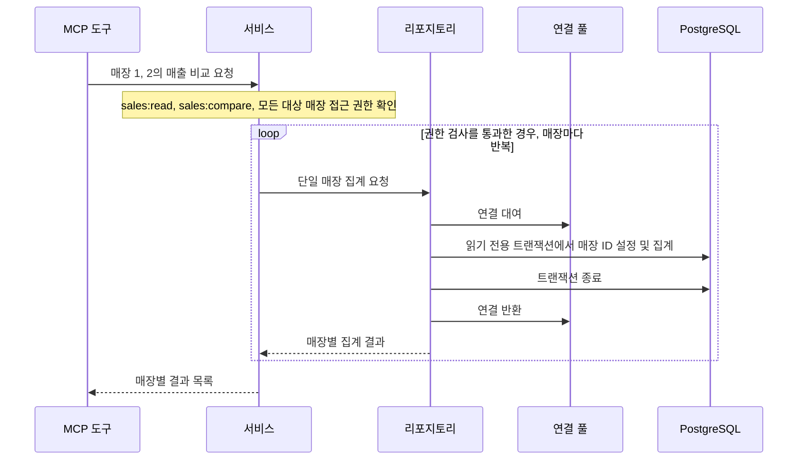

# 업무 도구 확장하기

매장 관리자는 매출이 높은 상품을 확인한 뒤, 같은 기간의 총매출과 주문 건수를 알고 싶을 수 있습니다. 여러 매장을 담당한다면 매장별 실적도 비교할 수 있어야 합니다. 이번 실습에서는 [실습 05: MCP 서버 구현](../05-MCP-Server/README.md)에서 구현한 매출 상위 상품 조회(`get_top_products`)를 바탕으로 **매장별 매출 요약**, **담당 매장 간 실적 비교**, 그리고 클라이언트가 데이터 구조를 확인할 수 있는 **스키마 탐색** 도구를 추가합니다.

이번 실습의 도구도 [실습 01: 아키텍처](../01-Architecture/README.md)에서 나눈 계층의 책임을 따릅니다. 프로토콜 계층은 입력 형식을 검증하고 MCP 응답을 만듭니다. 서비스는 권한과 업무 규칙을 확인한 뒤 리포지토리에 조회를 요청합니다. 리포지토리는 풀에서 연결을 빌려 SQL을 실행하고 연결을 반환합니다.

---

## 학습 목표

이 실습을 마치면 다음을 할 수 있습니다.

- 주문 건수와 매출액의 집계 단위를 구분하고, 일대다 조인으로 같은 주문을 여러 번 세는 오류를 방지할 수 있습니다.
- 여러 매장의 접근 권한을 조회 전에 확인하고, 매장별 트랜잭션에서 단일 매장 집계를 재사용할 수 있습니다.
- 매출 조회 권한(`sales:read`)과 메타데이터 조회 권한(`schema:read`)을 구분하고, 스키마 탐색 도구가 반환할 정보를 허용 목록으로 제한할 수 있습니다.
- MCP Inspector에서 도구를 호출해 구조화된 결과와 권한 오류를 확인할 수 있습니다.

---

## 1. 매장별 매출 요약 구현하기 (`get_sales_summary`)

### 목표

지정한 매장과 기간의 **매출 합계와 주문 건수**를 반환하는 도구를 구현합니다. 매출 상위 상품 조회에 사용한 `sales:read` 권한과 매장 접근 권한 검사를 재사용합니다.

### 주문 건수와 매출액의 집계 단위

"매장 1의 2020년 6월 총매출과 주문 건수는 얼마인가요?"라는 요청을 예로 들어 보겠습니다. 도구는 `store_id`와 `start_date`, `end_date`를 받습니다. 집계 기간은 [실습 04: 데이터베이스](../04-Database/README.md#주문과-주문-상세-나누기)에서 정의한 `orders.order_date`를 기준으로 합니다.

주문 하나에 주문 상세 행이 세 개 있다면, `orders`와 `order_items`를 조인한 결과에도 같은 주문 ID가 세 번 나타납니다. 주문 건수는 주문을 기준으로 세고, 매출액은 주문 상세 행의 거래 금액을 합산합니다.

| 집계 대상 | 집계 방법 | 이유 |
| :--- | :--- | :--- |
| **주문 건수** | `COUNT(DISTINCT o.order_id)` | `COUNT(*)`는 조인 결과의 세 행을 모두 셉니다. 주문 ID의 중복을 제거하면 1건입니다. |
| **매출 합계** | `COALESCE(SUM(oi.total_amount), 0)` | 각 주문 상세 행의 거래 금액을 한 번씩 더합니다. 합산할 금액이 없으면 0을 사용합니다. |

리포지토리는 읽기 전용 트랜잭션에서 승인된 매장 ID를 `set_config('app.current_store_id', $1, true)`로 설정합니다. 같은 연결에서 아래 집계 쿼리를 실행합니다. 쿼리의 매개변수는 매장 ID, 시작일, 종료일 순입니다.

```sql
SELECT
    COUNT(DISTINCT o.order_id) AS order_count,
    COALESCE(SUM(oi.total_amount), 0) AS total_sales
FROM retail.orders o
LEFT JOIN retail.order_items oi
    ON o.order_id = oi.order_id AND o.store_id = oi.store_id
WHERE o.store_id = $1
  AND o.order_date BETWEEN $2 AND $3;
```

> [!NOTE]
> 조회 기간에 주문이 없으면 주문 건수는 `0`, 매출 합계는 `"0.00"`을 반환합니다.

### 도구 인터페이스 규격

#### 입력 파라미터 규격

| 파라미터 | 타입 | 제약 조건 | 설명 |
| :--- | :--- | :--- | :--- |
| `store_id` | `int` (`StrictInt`) | 양의 정수, 사용자 허용 매장 목록 포함 필수 | 조회 대상 매장 ID |
| `start_date` | `str` (`ToolDate`) | `YYYY-MM-DD` 정규식 일치, 유효한 달력 날짜 | 집계 시작일 (포함) |
| `end_date` | `str` (`ToolDate`) | `YYYY-MM-DD` 정규식 일치, 시작일 ≤ 종료일, 최대 366일 | 집계 종료일 (포함) |

#### 출력 데이터 규격 (`SalesSummaryOutput`)

```json
{
  "store_id": 1,
  "start_date": "2020-06-01",
  "end_date": "2020-06-30",
  "total_sales": "114863.63",
  "order_count": 496
}
```

* `total_sales`: 집계한 금액을 Python의 `Decimal`로 유지하고, 소수점 아래 두 자리까지 표시한 문자열로 반환합니다.
* `order_count`: 기간 내 고유 주문 수(정수)입니다.

### 오류 처리 규격 (`ToolError`)

| 발생 상황 | 내부 예외 | 클라이언트 반환 `ToolError` 메시지 |
| :--- | :--- | :--- |
| 날짜 형식 오류 (예를 들어 `2020/06/01`) | SDK 입력 검증 | SDK가 입력 형식 오류를 반환합니다. |
| 달력에 없는 날짜 (예를 들어 `2020-06-31`) | `ValueError` | `"시작일과 종료일은 유효한 달력 날짜여야 합니다"` |
| 매출 조회 권한 또는 매장 접근 권한 없음 | `PermissionDeniedError` | `"요청한 매장의 매출 조회 권한이 없습니다"` |
| 조회 조건 위반 | `ValueError` | `"조회 조건을 확인하세요. 매장 ID, 날짜 순서와 최대 366일을 확인하세요"` |
| DB 시간 초과 | `SalesQueryTimeoutError` | `"매출 조회 시간이 초과되었습니다"` |
| 그 밖의 DB 조회 실패 | `SalesQueryError` | `"데이터베이스에서 매출을 조회하지 못했습니다"` |

### 진행할 작업 및 MCP Inspector 검증

1. `SalesService.sales_summary()`에서 기존 매출 조회 권한과 매장 접근 권한 검사, 기간 검증을 재사용합니다.
2. `SalesRepository.sales_summary()`에서 승인된 매장 ID를 적용하고, 주문 ID를 중복 없이 세어 매출액과 함께 반환합니다.
3. `server.py`에서 응답 모델 `SalesSummaryOutput`을 정의하고, `@server.tool(structured_output=True)`로 `get_sales_summary`를 등록합니다.
4. 서버를 실행한 뒤 별도 터미널에서 MCP Inspector를 실행합니다. Inspector에는 Node.js 22.19.0 이상이 필요합니다. [MCP Inspector 실행 안내](https://modelcontextprotocol.io/docs/2026-07-28/tools/inspector#quickstart)

```powershell
# 터미널 1: 서버 실행
uv run --locked --env-file .env.reader python -m zava_mcp_server

# 터미널 2: MCP Inspector 실행 (브라우저 자동 실행)
npx @modelcontextprotocol/inspector
```

- Inspector에서 서버를 추가합니다. 전송 방식은 `Streamable HTTP`, URL은 `http://127.0.0.1:8000/mcp`로 지정합니다. 서버의 포트나 경로를 변경했다면 실제 실행 주소를 사용합니다.
- `sales:read`와 매장 1 접근 권한을 가진 개발용 사용자로 `get_sales_summary`를 호출합니다. 매장 1과 `2020-06-01`부터 `2020-06-30`까지를 입력하고 결과를 위 응답 예시와 비교합니다.
- Inspector에서 사용자 설정에 없는 매장 ID를 요청해 권한 오류를 확인합니다. 단위 테스트에서는 거부된 요청이 리포지토리를 호출하지 않는지 확인합니다.

### 완료 기준

- MCP Inspector 호출에서 매장·기간과 함께 기대한 매출 합계와 주문 건수가 정확히 반환됩니다.
- 한 주문에 여러 품목이 포함되어 있어도 주문 건수는 1건으로 집계되며, 주문이 없는 기간에는 `order_count: 0`, `total_sales: "0.00"`이 반환됩니다.
- `sales:read`가 없거나 접근할 수 없는 매장을 요청하면 권한 오류가 반환됩니다. 단위 테스트에서 두 경우 모두 리포지토리가 호출되지 않음을 확인합니다.

---

## 2. 담당 매장 간 매출 비교 구현하기 (`compare_store_sales`)

### 목표

매장 관리자는 자기 매장의 실적을 조회하고, 임원은 한 번의 요청으로 허용된 여러 매장의 같은 기간 실적을 비교합니다. `sales:read`는 매출을 조회할 권한이고, `sales:compare`는 여러 매장의 실적을 비교할 권한입니다. 비교 도구는 두 작업 권한과 모든 대상 매장의 접근 권한을 확인한 뒤 1절의 단일 매장 집계를 재사용합니다.

### 매장별 조회를 실행하는 순서

매장 1과 매장 2의 실적을 비교하려면 서비스가 두 매장의 접근 권한을 모두 확인해야 합니다. 검사를 통과하면 리포지토리가 매장마다 읽기 전용 트랜잭션을 열고 단일 매장 집계를 실행합니다.



이 실습에서는 1절의 조회를 재사용하므로 트랜잭션 하나에 매장 ID 하나를 적용합니다. 설정한 매장 ID는 해당 트랜잭션에서만 유효합니다. 조회가 끝나면 연결을 반환하고 다음 매장을 조회합니다.

### 도구 인터페이스 규격

#### 입력 파라미터 규격

| 파라미터 | 타입 | 제약 조건 | 설명 |
| :--- | :--- | :--- | :--- |
| `store_ids` | 정수 배열 | 양의 정수 ID만 허용합니다. 중복 제거 후 서로 다른 매장이 2~10개여야 합니다. | 처음 등장한 순서대로 조회하고 반환할 매장 ID 목록 |
| `start_date` | `str` (`ToolDate`) | `YYYY-MM-DD` 정규식 일치, 유효한 달력 날짜 | 공통 집계 시작일 |
| `end_date` | `str` (`ToolDate`) | `YYYY-MM-DD` 정규식 일치, 시작일 ≤ 종료일, 최대 366일 | 공통 집계 종료일 |

#### 출력 데이터 규격 (`CompareStoreSalesOutput`)

```json
{
  "start_date": "2020-06-01",
  "end_date": "2020-06-30",
  "stores": [
    {
      "store_id": 1,
      "total_sales": "114863.63",
      "order_count": 496
    },
    {
      "store_id": 2,
      "total_sales": "78017.30",
      "order_count": 344
    }
  ]
}
```

### 오류 처리 규격 (`ToolError`)

- `sales:read` 또는 `sales:compare` 권한이 없거나 접근할 수 없는 매장이 하나라도 있으면 첫 조회 전에 요청 전체를 거부합니다.
- 중복을 제거한 뒤 매장이 2개 미만이거나 10개를 초과하면 `"비교할 매장은 2개 이상 10개 이하여야 합니다"` 오류를 반환합니다.
- 매장 조회 중 DB 오류가 발생하면 요청 전체를 오류로 반환합니다. 시간 초과와 일반 조회 실패는 1절과 같은 오류 메시지를 사용합니다.

### 진행할 작업 및 MCP Inspector 검증

1. `models.py`에 `SALES_COMPARE = "sales:compare"`를 정의하고, `UserContext.allowed_actions`에서 이 권한을 허용합니다.
2. `services.py`에 매장 비교 기능을 추가합니다. 매장 ID를 검증하고 중복을 제거한 뒤 매장 수와 조회 기간을 확인합니다. `sales:read`, `sales:compare`, 모든 대상 매장의 접근 권한을 검사합니다.
3. 검사를 통과하면 1절의 단일 매장 집계 메서드를 매장마다 호출하고 결과를 모읍니다.
4. `tools/compare_store_sales.py`에 도구를 정의하고 `server.py`에서 등록합니다.
5. 매장 관리자 개발용 사용자에 `sales:read`와 매장 1 접근 권한을 설정합니다. Inspector에서 매장 1의 `get_sales_summary` 호출이 성공하고 매장 1·2의 비교가 거부되는지 확인합니다.
6. 임원 개발용 사용자에 `sales:read`, `sales:compare`, 매장 1·2 접근 권한을 설정하고 서버를 다시 시작합니다. Inspector에서 `store_ids: [1, 2]`와 2020년 6월 기간을 입력합니다. 각 매장의 결과를 위 예시 및 단일 매장 조회 결과와 비교합니다.
7. 임원 사용자로 허용된 매장과 허용되지 않은 매장을 함께 요청해 권한 오류를 확인합니다. 단위 테스트에서는 이 요청이 리포지토리를 한 번도 호출하지 않는지 확인합니다.
8. 임원 사용자 설정에서 `sales:compare`만 임시로 빼고 서버를 다시 시작합니다. 매장 1·2 접근 권한과 `sales:read`가 있어도 비교 요청이 거부되는지 확인합니다. 확인한 뒤 `sales:compare`를 복원하고 서버를 다시 시작합니다.

### 완료 기준

- MCP Inspector 호출에서 복수 매장의 매출 합계와 주문 건수가 단일 매장 요약 결과와 일치하게 반환됩니다.
- 서비스가 단일 매장 집계를 재사용합니다. 매장별 집계가 끝나면 트랜잭션을 종료하고 연결을 반환한 뒤 다음 매장을 조회합니다.
- `sales:read` 누락, `sales:compare` 누락, 접근 범위 밖의 매장 요청은 모두 거부됩니다. 단위 테스트에서 세 경우 모두 리포지토리가 호출되지 않음을 확인합니다.

---

## 3. 매출 분석 테이블의 스키마 탐색 구현하기 (`get_table_schema`)

### 목표

클라이언트가 매출 집계에 쓰이는 테이블의 열, 자료형, 기본 키와 외래 키를 확인하는 도구를 구현합니다. PostgreSQL 시스템 카탈로그에서 허용된 테이블의 메타데이터만 조회합니다.

### 조회할 수 있는 스키마 정보

"주문 상세(`order_items`)는 주문(`orders`)과 어떤 열로 연결되나요?"라는 질문에는 거래 데이터가 아닌 테이블 구조인 **메타데이터(Metadata)**가 필요합니다.

1. **권한 검사**. 스키마 정보를 조회하려면 `schema:read`가 필요합니다. 매출 조회 권한인 `sales:read`와 별도로 부여합니다.
2. **테이블 허용 목록 확인**. 서비스는 `retail.orders`, `retail.order_items`, `retail.products`에 대한 요청만 허용합니다. 입력은 테이블 이름이며, 조회하는 스키마는 `retail`로 고정합니다.
3. **시스템 카탈로그 조회**. 권한과 테이블을 확인한 뒤 열, 자료형, 키 정보를 읽습니다.
4. **외래 키 참조 대상 확인**. 참조 대상도 스키마와 테이블 이름이 모두 허용 목록에 있을 때만 관계를 반환합니다. 예를 들어 `order_items`에서 `orders`를 참조하는 관계는 반환하지만, `orders`에서 `customers`를 참조하는 관계는 제외합니다.

### 도구 인터페이스 규격

#### 입력 파라미터 규격

| 파라미터 | 타입 | 제약 조건 | 설명 |
| :--- | :--- | :--- | :--- |
| `table_name` | 문자열 | `orders`, `order_items`, `products` 중 하나 | `retail` 스키마에서 조회할 테이블 이름 |

#### 출력 데이터 규격 (`TableSchemaOutput`)

```json
{
  "table_name": "order_items",
  "columns": [
    { "column_name": "order_item_id", "data_type": "integer", "is_nullable": false },
    { "column_name": "order_id", "data_type": "integer", "is_nullable": false },
    { "column_name": "store_id", "data_type": "integer", "is_nullable": false },
    { "column_name": "product_id", "data_type": "integer", "is_nullable": false },
    { "column_name": "quantity", "data_type": "integer", "is_nullable": false },
    { "column_name": "unit_price", "data_type": "numeric(10,2)", "is_nullable": false },
    { "column_name": "discount_percent", "data_type": "integer", "is_nullable": false },
    { "column_name": "discount_amount", "data_type": "numeric(10,2)", "is_nullable": false },
    { "column_name": "total_amount", "data_type": "numeric(10,2)", "is_nullable": false }
  ],
  "primary_key": ["order_item_id"],
  "foreign_keys": [
    {
      "constrained_columns": ["order_id", "store_id"],
      "referenced_table": "orders",
      "referenced_columns": ["order_id", "store_id"]
    },
    {
      "constrained_columns": ["product_id"],
      "referenced_table": "products",
      "referenced_columns": ["product_id"]
    }
  ]
}
```

### 오류 처리 규격 (`ToolError`)

* 사용자의 `allowed_actions`에 `schema:read`가 없으면 `"스키마 정보 조회 권한이 없습니다"`를 반환합니다.
* 허용 목록에 없는 테이블(예: `customers`)을 요청하면 `"공개 대상이 아닌 테이블이거나 존재하지 않는 테이블입니다"`를 반환합니다.

### 진행할 작업 및 MCP Inspector 검증

1. `models.py`의 `UserContext`가 `allowed_actions` 값으로 `schema:read`를 허용하도록 확장합니다. 그런 다음 개발용 사용자 설정의 `allowed_actions`에 `schema:read`를 추가합니다.
2. `database.py`에서 시스템 카탈로그를 조회합니다. `pg_attribute`로 열을, `pg_constraint`로 기본 키와 외래 키를 확인합니다. `format_type`으로 `numeric(10,2)`처럼 길이나 정밀도 정보가 포함된 자료형을 표시하고, 여러 열로 이루어진 키의 열 순서를 보존합니다.
3. `services.py`에서 `schema:read`와 요청 테이블을 검사합니다. 외래 키는 참조 대상의 스키마와 테이블 이름이 모두 허용 목록에 일치하는 관계만 반환합니다.
4. `server.py`에 `get_table_schema` 도구를 등록합니다.
5. 서버를 다시 시작한 뒤 Inspector에서 `order_items`를 조회합니다. 기본 키와 외래 키가 위 응답 예시와 일치하는지 확인합니다. `orders`의 응답에는 `customers`를 참조하는 외래 키가 빠져 있는지 확인합니다.
6. `schema:read`를 임시로 제거하고 서버를 다시 시작한 뒤 Inspector에서 권한 오류를 확인합니다. 단위 테스트에서는 권한이 없거나 허용 목록 밖의 테이블을 요청할 때 리포지토리가 호출되지 않는지 확인합니다.

### 완료 기준

- `order_items`의 기본 키 `order_item_id`와 `orders`, `products`를 참조하는 외래 키가 실제 스키마와 일치합니다. `orders`를 참조하는 복합 외래 키의 열 순서도 일치합니다.
- `orders`의 응답에는 허용 목록에 없는 `customers`를 참조하는 외래 키가 포함되지 않습니다.
- `schema:read`가 없거나 허용 목록 밖의 테이블을 요청하면 오류를 반환합니다. 단위 테스트에서 두 경우 모두 리포지토리가 호출되지 않음을 확인합니다.

---

## 핵심 요약

- **업무 질문을 기준으로 도구를 설계합니다.** 도구가 어떤 질문에 답할지 정하고, 반환할 지표의 의미와 조회 범위를 정의합니다. 매장별 요약과 매장 간 비교에는 같은 집계 기준을 적용합니다.
- **작업을 수행할 권한과 대상 데이터에 접근할 권한을 구분합니다.** 매장 간 실적을 비교할 때는 비교 작업을 수행할 권한과 요청한 각 매장에 접근할 권한이 필요합니다. 여러 매장을 한 번에 요청하면 전체 요청의 권한을 확인한 뒤 조회를 시작합니다.
- **메타데이터도 도구가 공개하는 정보입니다.** 테이블 구조를 알려주는 도구는 클라이언트가 업무를 수행하는 데 필요한 정보의 범위를 정해야 합니다. 테이블과 열뿐 아니라 테이블 사이의 관계에도 같은 공개 기준을 적용합니다.
- **검증하려는 동작에 맞는 증거를 확인합니다.** 클라이언트에서 권한 오류를 확인하면 요청이 거부되었음을 알 수 있습니다. 조회를 시작하기 전에 거부했는지 확인하려면 데이터 접근이 실제로 시도되었는지 별도로 검증합니다.

---

## 다음 단계

[실습 07: 시맨틱 검색](../07-Semantic-Search/README.md)에서는 이번에 확장한 MCP 서버에 상품 검색 도구를 추가합니다. 검색어와 상품 설명의 의미를 비교해 사용자가 자연어로 설명한 상품을 찾습니다.

## 추가 리소스

### MCP 도구 설계

- [MCP Python SDK 도구 문서](https://py.sdk.modelcontextprotocol.io/servers/tools/). 함수의 매개변수와 반환 자료형이 도구의 입력·출력 형식에 어떻게 반영되는지 확인합니다.

### PostgreSQL 메타데이터

- [PostgreSQL `pg_constraint` 문서](https://www.postgresql.org/docs/18/catalog-pg-constraint.html). 시스템 카탈로그에서 기본 키와 외래 키를 식별하고, 외래 키가 참조하는 테이블과 열을 확인합니다.
