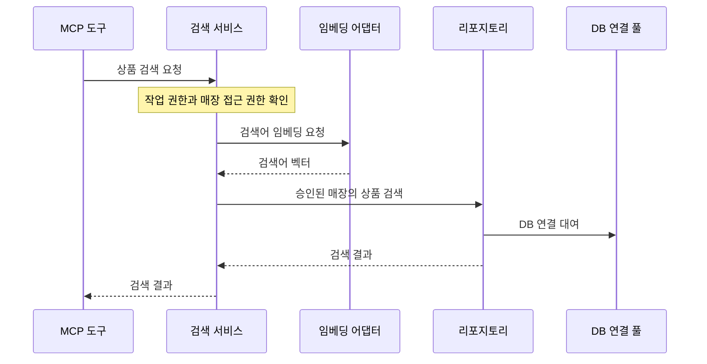

# 상품 시맨틱 검색 구현하기

“좁은 작업 공간에서 쓰고 접어 둘 수 있는 작업대를 찾아줘.” 상품 설명에 검색어가 그대로 들어 있지 않아도, 설명의 의미를 비교하면 관련 상품을 찾을 수 있습니다. 이처럼 검색어와 상품 설명의 의미를 비교하는 방식을 시맨틱 검색(Semantic Search)이라고 합니다.

[실습 06](../06-Tools/README.md)에서 확장한 MCP 서버에 승인된 매장의 상품을 찾는 검색 도구를 추가합니다. 상품명과 설명은 미리 벡터로 변환해 PostgreSQL에 저장합니다. 요청이 들어오면 로컬 모델로 검색어만 변환하고, `pgvector`로 해당 매장의 상품 벡터와 비교합니다. 텍스트의 의미를 수치로 표현한 이 벡터를 임베딩(Embedding)이라고 합니다.

이 실습의 기본 모델은 로컬에서 실행하는 EmbeddingGemma 2입니다. 임베딩 제공자를 바꿀 때는 [실습 01에서 다룬 Azure OpenAI](../01-Architecture/README.md)를 선택할 수 있습니다.

## 학습 목표

- 상품을 미리 임베딩하는 작업과 검색 요청을 처리하는 작업을 구분할 수 있습니다.
- 검색 도구가 반환할 정보와 검색할 수 있는 상품의 범위를 정의할 수 있습니다.
- 같은 검색에서 비교할 수 있는 벡터를 생성하려면 모델과 입력 방식을 어떻게 맞춰야 하는지 설명할 수 있습니다.
- 권한 검사, 모델 추론, DB 조회의 순서를 정하고, 검색 결과의 관련성과 매장 접근 범위를 각각 검증할 수 있습니다.

## 1. 상품 검색 도구의 계약 정하기

### 목표

`search_products`가 어떤 질문에 답하는지, 어떤 상품을 검색하고 어떤 정보를 반환하는지 정합니다.

### 공용 카탈로그와 매장별 검색 범위

상품명과 설명은 모든 매장이 공유하는 `retail.products`에 있습니다. 따라서 같은 상품의 벡터를 매장별로 복제할 필요가 없습니다. 어떤 매장에서 상품을 취급하는지는 `retail.inventory`에서 확인합니다. 이번 실습에서는 해당 매장의 재고 행이 있으면 취급 상품으로 봅니다. 수량이 0인 상품도 결과에 포함될 수 있으므로, 검색 결과가 현재 구매 가능 여부를 보장하지는 않습니다 ([실습 데이터의 상품과 재고](../../data/README.md) 참조).

### 진행할 작업

- 도구의 입력은 검색어(`query`), 대상 매장(`store_id`), 최대 결과 수(`limit`)로 정합니다. 검색어는 공백만 있는 값을 거부하고 길이 상한을 둡니다. 결과 수에도 상한을 정합니다.
- 검색 결과는 상품 ID, 상품명, 상품 설명, 유사도 점수를 포함하는 목록으로 정합니다. 조건에 맞는 후보가 없으면 빈 목록을 반환합니다.
- `models.py`에서 `catalog:read`를 작업 권한으로 정의하고 `UserContext.allowed_actions`에서 허용합니다. 검색 서비스는 이 권한과 대상 매장 접근 권한을 모두 확인합니다.

### 완료 기준

- 입력과 응답 형식, 검색 대상의 범위가 도구 설명에 명시되어 있습니다.
- 해당 매장에서 취급하는 상품과 현재 재고가 있는 상품의 차이를 설명할 수 있습니다. 검색 응답에는 상품 관련성을 판단하는 데 필요한 정보가 포함됩니다.

## 2. 상품 임베딩을 생성하고 저장하기

### 목표

[실습 04](../04-Database/README.md)에서 적재한 공용 상품 카탈로그를 읽어 상품 임베딩을 일괄 생성해 저장하는 명령을 구현합니다.

### 상품과 검색어를 비교할 수 있게 만들기

모델에는 상품명과 설명을 함께 전달합니다. 상품명은 제목으로, 설명은 본문으로 사용합니다. 상품을 준비할 때는 모델의 문서용 입력 방식(`Document`)을, 요청을 처리할 때는 검색어용 입력 방식(`SearchQuery`)을 사용합니다. 두 입력은 서로 다른 역할을 맡지만, 같은 모델의 호환되는 벡터 공간에 놓여야 거리를 비교할 수 있습니다 ([EmbeddingGemma 2 모델 카드](https://ai.google.dev/gemma/docs/embeddinggemma/model_card_2?hl=en) 참조).

실습의 모델은 `google/embeddinggemma-2`이며 기본 출력 차원인 768을 사용합니다. Sentence Transformers 6.1 이상을 사용해 Python 프로세스에서 텍스트를 임베딩합니다. 저장된 벡터에는 모델 ID와 리비전, 상품 텍스트를 구성한 방식처럼 호환성을 판단하는 데 필요한 설정을 기록합니다. 벡터의 차원이 같아도 모델이나 입력 규약을 바꾸면 기존 벡터와 비교할 수 있는지 다시 확인해야 합니다 ([EmbeddingGemma 2 실행 가이드](https://huggingface.co/docs/transformers/model_doc/embedding_gemma2) 참조).

### 진행할 작업

- PostgreSQL에 `vector` 확장이 활성화되어 있는지 확인합니다. 상품 ID를 공용 카탈로그와 연결하고 `vector(768)`을 저장할 테이블을 추가합니다. 이 실습에서 사용하는 모델과 입력 설정을 저장된 벡터와 함께 확인할 수 있게 합니다.
- 로컬 모델을 한 번 로드해 재사용하는 임베딩 어댑터를 만듭니다. 준비 명령과 검색 서버가 같은 어댑터를 사용하되, 각각 문서용과 검색어용 변환을 호출하도록 구성합니다.
- 상품 임베딩을 일괄 생성해 저장하는 명령을 구현합니다. 카탈로그를 읽고 상품 텍스트를 임베딩한 뒤, 각 벡터를 상품 ID에 연결해 저장합니다. 모델 추론을 하는 동안 DB 연결을 점유하지 않도록 읽기, 변환, 저장을 나눕니다.
- 준비 명령은 필요한 쓰기 권한으로 실행합니다. MCP 서버의 조회 전용 계정에는 임베딩 테이블의 조회 권한을 부여합니다. 준비 명령을 다시 실행하면 같은 상품의 벡터를 갱신하도록 저장 방식을 정합니다.

### 완료 기준

- 제공 카탈로그의 상품 424개에 대해 상품 ID와 임베딩을 대조할 수 있고, 명령을 다시 실행해도 상품 벡터가 중복되지 않습니다.
- 저장된 벡터는 768차원이며, 코사인 거리를 계산할 수 있도록 유한한 값으로 이루어진 0이 아닌 벡터인지 확인합니다. 기록된 모델과 입력 설정이 검색에서 사용하는 설정과 맞습니다.
- 조회 전용 계정으로 임베딩을 읽을 수 있습니다. 상품 임베딩을 저장하는 작업은 준비 명령에서 수행합니다.

## 3. 시맨틱 검색을 MCP 도구로 연결하기

### 목표

기존 MCP 서버에 상품 검색을 연결합니다. [실습 01](../01-Architecture/README.md#2-시맨틱-제품-검색-흐름-a-semantic-product-search)에서 정의한 계층별 책임에 따라 서비스가 검색 요청을 처리하고, 임베딩 어댑터가 모델을 호출하며, 리포지토리가 DB를 조회합니다.

### 권한 확인, 추론, DB 조회의 순서

서버는 시작할 때 임베딩 모델을 로드해 요청 간에 재사용합니다. 검색 요청이 들어오면 서비스가 먼저 작업 권한과 매장 접근 권한을 확인합니다. 권한 검사를 통과하면 서비스가 임베딩 어댑터에 검색어를 전달합니다. 서비스가 벡터를 받아 리포지토리를 호출하면, 리포지토리는 그때 풀에서 DB 연결을 빌립니다. 모델이 추론하는 동안에는 다른 요청이 풀의 연결을 사용할 수 있습니다.

리포지토리는 읽기 전용 트랜잭션에서 승인된 매장 ID를 설정합니다. 해당 매장에 재고 행이 있고 현재 모델 설정과 호환되는 벡터가 있는 상품을 후보로 삼은 뒤, 코사인 거리가 가까운 순서로 최대 결과 수만큼 반환합니다. 전체 카탈로그에서 먼저 상위 결과를 뽑으면 매장 조건을 적용한 뒤 더 적은 결과가 남을 수 있으므로, **매장 조건을 적용한 후보 안에서 순위를 정합니다.**

이 실습에서는 매장 조건과 모델 호환 조건을 충족한 모든 상품 벡터와 검색어 벡터 사이의 거리를 계산합니다. 이를 정확 검색(Exact Search)이라고 합니다. 검색 결과에는 `1 - 코사인 거리`로 계산한 유사도 점수를 표시합니다 ([pgvector 검색과 거리](https://github.com/pgvector/pgvector#querying) 참조).

### 진행할 작업

- 서버 수명주기에 임베딩 어댑터를 연결합니다. 모델을 시작할 때 한 번 로드하고 검색 도구가 요청마다 같은 어댑터를 사용하게 합니다.
- 검색 서비스에서 입력과 권한을 확인한 뒤 검색어를 임베딩합니다. 어댑터는 벡터가 저장 규격과 맞는지 확인합니다.
- 리포지토리에서 기존 매장 ID 설정과 `inventory`의 행 수준 보안(RLS)을 적용합니다. 매장 조건으로 후보를 좁힌 뒤 코사인 거리순으로 조회합니다 ([매장별 재고 RLS 정책](../../sql/14_inventory_rls.sql) 참조).
- `search_products`를 MCP 도구로 등록하고, 검색 결과를 1절에서 정한 구조로 반환합니다.

### 완료 기준

- MCP 클라이언트에서 도구를 호출하면 승인된 매장의 관련 상품이 순위대로 반환됩니다. 후보가 없으면 빈 목록이 반환됩니다.
- 권한 검사를 통과한 뒤 모델을 호출하고, 벡터를 받은 뒤 DB 연결을 빌리는 순서를 확인할 수 있습니다.

## 4. 검색 결과와 접근 범위 검증하기

### 목표

검색 결과가 질문과 관련 있는지와, 허용된 매장의 상품만 포함하는지를 각각 확인합니다.

### 검색 품질과 매장별 접근 범위

검색 품질을 보려면 카탈로그를 먼저 살펴보고 검색어별로 어떤 상품이 관련 있는지 정합니다. 예를 들어 “접어서 보관할 수 있는 휴대용 작업대”에는 `Folding Workbench Portable`을, “야외 목재에 바를 자외선 차단 마감재”에는 `Deck and Fence Stain`을 상위 결과의 후보로 볼 수 있습니다. 실제로 반환된 상품명과 설명을 읽고, 관련성이 낮은 상품이 함께 나왔는지도 확인합니다 ([실습 상품 데이터](../../data/README.md) 참조).

제공 데이터에서는 모든 매장에 동일한 424개 상품의 재고 행이 있습니다. 매장 번호를 바꿔 같은 결과가 나와도 매장 필터가 올바른지 판단하기 어렵습니다. 접근 범위를 검증할 때는 두 매장이 서로 다른 상품을 취급하는 작은 테스트 데이터를 사용합니다. 재고가 0인 취급 상품과 해당 매장의 재고 행이 없는 상품을 구분할 수 있는 사례도 포함합니다 ([실습 재고 데이터](../../data/README.md#재고--inventorycsv) 참조).

### 진행할 작업

- 개발용 사용자에게 `catalog:read`와 대상 매장 접근 권한을 부여하고 서버를 다시 시작합니다. 실습 06과 같은 방식으로 MCP Inspector에서 검색 도구를 호출하고, 상위 결과의 상품명과 설명을 기대한 후보와 비교합니다.
- `catalog:read`가 없거나 대상 매장에 접근할 수 없는 경우를 각각 검증합니다. Inspector에서 권한 오류를 보고, 단위 테스트에서는 임베딩 어댑터와 리포지토리가 호출되지 않았는지 확인합니다.
- 매장마다 취급 상품이 다른 테스트 데이터로 DB 검색 경로를 확인합니다. 다른 매장에만 있는 상품이 검색어와 가장 가깝더라도 결과에 포함되지 않는지 확인합니다.

### 완료 기준

- 대표 검색어마다 관련 상품이 상위 결과에 나타나는지 확인하고, 상품 설명을 근거로 관련성을 설명할 수 있습니다.
- 권한이 없는 요청은 추론과 DB 조회 전에 거부됩니다. 권한이 있는 매장의 결과에는 해당 매장이 취급하는 상품만 포함됩니다.

## 핵심 요약

- **상품 준비와 검색 요청은 같은 벡터 표현을 공유합니다.** 상품을 미리 임베딩해 두면 요청에서는 검색어만 변환하면 됩니다. 무엇을 임베딩하고 어떤 모델과 설정을 사용하는지가 검색 결과에 영향을 줍니다.
- **검색 범위는 도구 계약의 일부입니다.** 매장 접근 권한은 요청을 처리할 수 있는지 결정하고, 매장별 취급 상품은 순위를 매길 후보를 결정합니다.
- **추론과 조회에 필요한 자원은 필요한 시점에 사용합니다.** 권한 검사 뒤에 추론을 시작하고, 벡터를 얻은 뒤 DB 연결을 빌립니다.
- **검색 품질과 접근 범위는 다른 증거로 검증합니다.** 카탈로그의 실제 설명은 상품 관련성을 판단하는 근거가 됩니다. 매장별 상품이 다른 테스트 데이터는 허용 범위를 넘어선 결과가 있는지 보여줍니다.

## 다음 단계

[실습 08: 테스트와 디버깅](../08-Testing/README.md)에서는 지금까지 구현한 도구의 정상 응답과 권한 거부, 데이터 접근을 어떻게 검증할지 다룹니다.

## 추가 리소스

### 로컬 임베딩

- [EmbeddingGemma 2 모델 카드](https://ai.google.dev/gemma/docs/embeddinggemma/model_card_2?hl=en). 상품 설명과 검색어에 적용할 입력 방식과 출력 차원을 확인합니다.
- [EmbeddingGemma 2 실행 가이드](https://huggingface.co/docs/transformers/model_doc/embedding_gemma2). Sentence Transformers로 공식 체크포인트를 불러와 임베딩하는 방법을 확인합니다.

### 벡터 검색

- [pgvector 공식 문서](https://github.com/pgvector/pgvector#querying). 벡터의 거리와 유사도를 계산하고 가까운 후보를 찾는 방법을 확인합니다.
