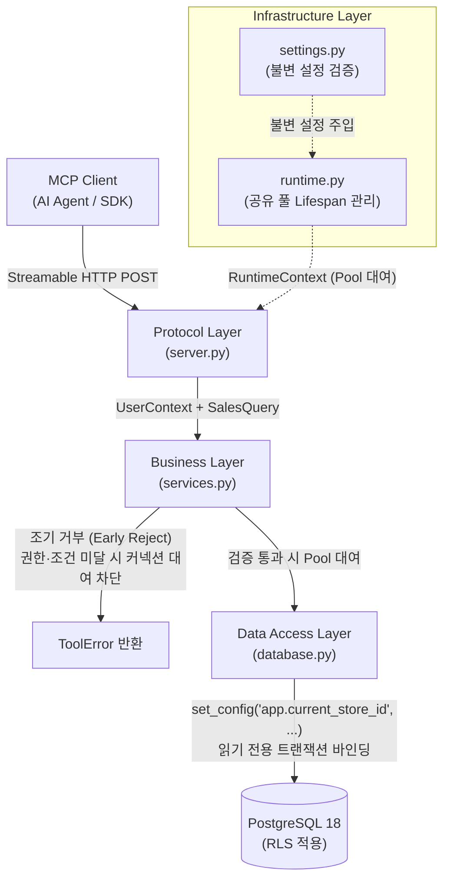

# Zava MCP Server

PostgreSQL의 행 수준 보안(Row-Level Security, RLS)을 적용하여 소매 데이터(주문, 재고, 매장)를 안전하게 조회하는 Model Context Protocol(MCP) 서버 패키지다.

---

## 목차 (Table of Contents)

1. [아키텍처 및 계층 구조](#1-아키텍처-및-계층-구조)
2. [제공 MCP 도구 명세 (`get_top_products`)](#2-제공-mcp-도구-명세-get_top_products)
3. [환경 설정 및 권한 준비](#3-환경-설정-및-권한-준비)
4. [서버 실행 및 HTTP 통신 검증](#4-서버-실행-및-http-통신-검증)
5. [내부 핵심 계층 세부 동작](#5-내부-핵심-계층-세부-동작)
6. [코드 품질 및 테스트 기준 (Quality Gate)](#6-코드-품질-및-테스트-기준-quality-gate)

---

## 1. 아키텍처 및 계층 구조

서버는 단일 책임 원칙과 보안 분리 원칙에 따라 4대 계층(Protocol, Business, Data Access, Infrastructure)으로 설계되었다. 비즈니스 계층의 권한 검증을 통과하기 전에는 DB 연결을 풀에서 대여하지 않는다(조기 거부, Early Reject).



### 모듈별 책임 및 보안 가드레일

| 계층 | 모듈 | 핵심 역할 | 보안 가드레일 (Never Do This) |
| :--- | :--- | :--- | :--- |
| **Protocol** | `server.py` | MCP 서버 객체 생성, `get_top_products` 도구 등록, Pydantic 파라미터 검증, Lifespan 서비스 주입 | 직접 SQL을 실행하거나 DB 풀에 접근하지 않는다. |
| **Business** | `services.py` | `UserContext` 권한(`sales:read`, 매장 ID) 및 날짜 범위(1~366일, 1~20건) 검증 | 권한 검증을 통과하기 전에 DB 커넥션을 풀에서 대여하지 않는다. |
| **Data Access** | `database.py` | 읽기 전용 트랜잭션 내 `set_config` RLS 매장 바인딩, 금액 집계 정렬 조회 | 문자열 조합 쿼리를 금지하며, DB 연결 객체 대신 도메인 모델을 반환한다. |
| **Infrastructure** | `settings.py`<br/>`runtime.py` | 불변 설정 로딩, 단일 연결 풀 수명주기(Lifespan) 관리 및 시작 준비 검사 | 비밀번호를 로그에 평문 출력하지 않으며, 관리자 계정(`.env`)을 사용하지 않는다. |
| **Domain Models** | `models.py` | 보안 주체(`UserContext`), 조회 조건(`SalesQuery`), 집계 결과 모델 | 불변 데이터 구조를 유지하며 비즈니스 로직을 포함하지 않는다. |
| **Entrypoint** | `__main__.py` | 설정 검증, 서비스 팩토리 구성 및 서버 실행 진입점 | 루프백 주소(`127.0.0.1`) 외의 임의 바인딩을 허용하지 않는다. |

---

## 2. 제공 MCP 도구 명세 (`get_top_products`)

`server.py`에 등록되어 외부에 노출되는 핵심 MCP 도구의 입출력 및 오류 규격이다.

### 2.1 도구 개요
* **도구명**: `get_top_products`
* **설명**: 지정한 매장과 기간의 주문 상세 거래 금액을 상품별로 합산해 매출 상위 상품을 반환한다. 집계 금액 동률 시 상품 ID 오름차순으로 정렬한다.

### 2.2 입력 파라미터 규격

| 파라미터 | 타입 | 제약 조건 | 설명 |
| :--- | :--- | :--- | :--- |
| `store_id` | `int` (`StrictInt`) | 양의 정수, 사용자 허용 매장 목록 포함 필수 | 조회 대상 매장 ID |
| `start_date` | `str` (`ToolDate`) | `YYYY-MM-DD` 정규식 일치, 실제 유효한 달력 날짜 | 집계 시작일 (시작일 포함) |
| `end_date` | `str` (`ToolDate`) | `YYYY-MM-DD` 정규식 일치, 시작일 ≤ 종료일, 최대 366일 | 집계 종료일 (종료일 포함) |
| `limit` | `int` (`StrictInt`) | 1 이상 20 이하의 정수 | 반환할 최대 상품 수 |

### 2.3 출력 데이터 규격 (`TopProductsOutput`)

구조화된 출력(`structured_output=True`)을 지원하며, 정상 조회 시 아래 형태의 JSON 데이터가 반환된다.

```json
{
  "store_id": 1,
  "start_date": "2020-01-01",
  "end_date": "2020-01-31",
  "products": [
    {
      "product_id": 400,
      "product_name": "Camp Kitchen Freeze-Dried Meals",
      "total_amount": "4044.96"
    },
    {
      "product_id": 403,
      "product_name": "Trail Snack Assortment (12-pack)",
      "total_amount": "3897.79"
    }
  ]
}
```

> [!NOTE]
> * `total_amount`는 부동소수점 오차를 방지하기 위해 데이터베이스의 정확한 `Decimal` 값을 소수점 문자열로 직렬화하여 반환한다.
> * 해당 기간 내 거래 내역이 없는 경우 `products`는 빈 목록(`[]`)으로 정상 반환된다.

### 2.4 오류 처리 규격 (`ToolError`)

인가 실패, 조건 불일치, DB 타임아웃 등의 예외는 MCP 프로토콜의 `isError: true` 결과로 변환되며, 클라이언트에게 명확한 안내 문구를 전달한다.

| 발생 원인 | 내부 예외 | 클라이언트 반환 `ToolError` 메시지 |
| :--- | :--- | :--- |
| 날짜 형식 오류 | `ValueError` | `"시작일과 종료일은 유효한 달력 날짜여야 합니다"` |
| 매장 권한 미달 | `PermissionDeniedError` | `"요청한 매장의 매출 조회 권한이 없습니다"` |
| 조건 위반 (범위/순서) | `ValueError` | `"조회 조건을 확인하세요. 매장 ID, 날짜 순서와 최대 366일, 결과 수 1~20을 확인하세요"` |
| DB 쿼리 시간 초과 | `SalesQueryTimeoutError` | `"매출 조회 시간이 초과되었습니다"` |
| 기타 데이터베이스 오류 | `SalesQueryError` | `"데이터베이스에서 매출을 조회하지 못했습니다"` |

---

## 3. 환경 설정 및 권한 준비

모든 작업은 프로젝트 루트에서 실행한다. 관리자 설정(`.env`)과 조회 전용 서비스 계정 설정(`.env.reader`)을 엄격히 구분하며, 최소 권한 원칙을 준수한다.

### 3.1 환경 동기화 및 설정 파일 준비

```powershell
uv sync --locked

# 로컬 개발자 설정 파일이 없으면 예시 파일을 복사해 준비한다
if (-not (Test-Path -LiteralPath config/dev-user.json)) {
    Copy-Item -LiteralPath config/dev-user.example.json -Destination config/dev-user.json
}

# 비밀번호를 출력하거나 DB에 접속하지 않고 설정 유효성 검증만 수행한다
uv run --locked --env-file .env.reader python -c "from zava_mcp_server.settings import load_settings; s = load_settings(); print(s.server); print(s.pool); print(s.user)"
```

- 새 환경의 DB 접속 정보는 루트의 [.env.reader.example](../.env.reader.example)을 참고하여 실제 조회 계정 정보로 `.env.reader`를 작성한다.
- `uv`가 환경 파일의 값을 실행 환경에 주입하며, Python 코드는 환경변수만 읽는다. 관리자(`.env`) 설정으로 임의 대체하지 않는다.

### 3.2 환경변수 상세 규격 (`settings.py`)

| 환경변수 | 필수 여부·기본값 | 검사 조건 | 설명 |
| :--- | :--- | :--- | :--- |
| `POSTGRES_HOST` | 필수 | 공백만으로 구성되지 않은 문자열 | PostgreSQL 호스트 주소 |
| `POSTGRES_PORT` | 필수 | 정수, 1~65,535 | PostgreSQL 포트 번호 |
| `POSTGRES_DB` | 필수 | 공백만으로 구성되지 않은 문자열 | 대상 데이터베이스 이름 |
| `POSTGRES_USER` | 필수 | 공백만으로 구성되지 않은 문자열 | 조회 전용 계정 (`zava_mcp_reader`) |
| `POSTGRES_PASSWORD` | 필수 | 비어 있지 않은 비밀 문자열 (`SecretStr`) | 조회 전용 계정 비밀번호 |
| `MCP_HOST` | `127.0.0.1` | 루프백 IP 또는 `localhost` | MCP HTTP 바인딩 호스트 |
| `MCP_PORT` | `8000` | 정수, 1~65,535 | MCP HTTP 포트 번호 |
| `MCP_PATH` | `/mcp` | `/`로 시작하며 `//`·공백·쿼리 제외 | MCP 엔드포인트 경로 |
| `DB_POOL_MIN_SIZE` | `1` | 0 이상의 정수 | 연결 풀 최소 연결 수 |
| `DB_POOL_MAX_SIZE` | `5` | 1 이상의 정수 | 연결 풀 최대 연결 수 (`MIN <= MAX`) |
| `DB_CONNECT_TIMEOUT`| `10`초 | 유한한 양수 (소수 허용) | 새 DB 연결 수립 제한 시간 |
| `DB_ACQUIRE_TIMEOUT`| `5`초 | 유한한 양수 (소수 허용) | 풀에서 연결을 대여하는 제한 시간 |
| `DB_QUERY_TIMEOUT`  | `10`초 | 유한한 양수 (소수 허용) | 개별 쿼리 실행 제한 시간 |
| `DB_SHUTDOWN_TIMEOUT`| `10`초 | 유한한 양수 (소수 허용) | 풀 안전 종료 대기 시간 |
| `DEV_USER_FILE` | `config/dev-user.json` | 비어 있지 않고 읽기 가능한 UTF-8 JSON 파일 경로 | 프로젝트 루트 기준 상대 경로 해석 |

### 3.3 개발용 사용자 권한 규격 (`config/dev-user.json`)

버전 관리되는 [config/dev-user.example.json](../config/dev-user.example.json)을 복사해 로컬 설정 파일(`config/dev-user.json`)을 준비한다. 실제 로컬 파일은 Git 추적에서 제외된다.

```json
{
  "user_id": "dev-manager",
  "allowed_actions": ["sales:read"],
  "allowed_store_ids": [1]
}
```

* **필수 필드**: `user_id`, `allowed_actions`, `allowed_store_ids` 세 필드 모두 필수이며 누락 시 검증 오류가 발생한다.
* **사용자 식별자**: 공백만으로 구성된 문자열은 허용하지 않는다.
* **허용 작업 및 매장**: JSON 배열이어야 하며, 매장 ID는 PostgreSQL `INTEGER` 범위의 양의 정수만 허용한다.
* **빈 배열(`[]`) 처리**: 명시적인 빈 배열은 '권한 없음'으로 정상 처리하며, 필드 누락이나 형식 오류와 엄격히 구분한다.
* **미정의 필드 차단**: 스키마에 정의되지 않은 필드가 포함되면 즉시 검증 오류를 발생시킨다 (`extra='forbid'`).
* **불변 집합 변환**: 중복을 제거하여 불변 집합(`frozenset`)으로 변환해 반환한다.
* **보안 한계 명시**: 이 정보는 개발 편의를 위한 가상 보안 주체(Principal) 정보이며 실제 인증 결과가 아니다. 실제 매장 접근 인가는 비즈니스 계층에서 수행한다.

---

## 4. 서버 실행 및 HTTP 통신 검증

### 4.1 서버 실행

프로젝트 루트의 첫 번째 터미널에서 실행한다.

```powershell
uv run --locked --env-file .env.reader python -m zava_mcp_server
```

> [!IMPORTANT]
> **네트워크 보안 제약**: 서버는 DNS 리바인딩 공격을 방어하기 위해 `MCP_HOST=127.0.0.1` 바인딩만 허용하며, Host는 `127.0.0.1:<실행 포트>`, Origin은 `http://127.0.0.1:<실행 포트>`만 허용한다. Origin 헤더가 없는 SDK 요청은 허용하지만 `localhost` 별칭이나 다른 출처는 거부한다.

### 4.2 도구 목록 확인 (CLI 클라이언트)

두 번째 터미널을 프로젝트 루트에서 열고 검증 스크립트를 실행한다. 클라이언트에는 DB 환경 파일이 필요하지 않다.

```powershell
uv run --locked python scripts/check_mcp_server.py http://127.0.0.1:8000/mcp
```

* `get_top_products`가 정상 등록되어 있으므로 예상 출력은 `["get_top_products"]`이며, 정상 종료 코드는 `0`이다. 통신에 15초 제한을 두며 실패 시 오류 안내와 함께 종료 코드 `1`을 반환한다.

### 4.3 도구 호출 및 구조화된 결과 검증 (SDK 클라이언트)

도구의 입출력 스키마와 실제 집계 결과를 확인하려면 두 번째 터미널에 아래 명령을 실행한다 (개발용 사용자가 매장 1을 조회할 수 있어야 한다).

```powershell
@'
import asyncio
import json
from mcp import Client

async def main():
    async with Client("http://127.0.0.1:8000/mcp") as client:
        for tool in (await client.list_tools()).tools:
            print(tool.model_dump_json(by_alias=True, exclude_none=True))
        result = await client.call_tool("get_top_products", {
            "store_id": 1,
            "start_date": "2020-01-01",
            "end_date": "2020-01-31",
            "limit": 5,
        })
        print(json.dumps(result.model_dump(mode="json", by_alias=True), ensure_ascii=False, indent=2))
        if result.is_error:
            raise SystemExit(1)

asyncio.run(main())
'@ | uv run --locked python -
```

#### 예상 반환 결과
기본 시드 데이터 기준으로 상위 5개 상품 순위와 집계 금액이 반환된다.

```json
{
  "content": [
    {
      "type": "text",
      "text": "..."
    }
  ],
  "structuredContent": {
    "store_id": 1,
    "start_date": "2020-01-01",
    "end_date": "2020-01-31",
    "products": [
      { "product_id": 400, "product_name": "...", "total_amount": "4044.96" },
      { "product_id": 403, "product_name": "...", "total_amount": "3897.79" },
      { "product_id": 402, "product_name": "...", "total_amount": "3879.16" },
      { "product_id": 36,  "product_name": "...", "total_amount": "3875.13" },
      { "product_id": 423, "product_name": "...", "total_amount": "3772.62" }
    ]
  },
  "isError": false
}
```

* **프로토콜 사양과 SDK 속성**: MCP 프로토콜 수준에서는 `isError` 필드가 반환되며, Python SDK 클라이언트 객체에서는 `result.is_error` 속성으로 이를 확인한다.
* **서버 종료**: 첫 번째 터미널에서 `Ctrl+C`를 누르고 정상 종료 완료 로그를 확인한다.

---

## 5. 내부 핵심 계층 세부 동작

### 5.1 DB 연결 풀 수명주기 (`runtime.py`)

서버 시작 시 공유 풀 하나를 생성하고 SDK Lifespan으로 관리한다. 단순 서버 객체 구성이나 모듈 import만으로는 DB에 접속하지 않는다.

* **시작 준비 검사**:
  - 접속 사용자와 DB 실제 `current_user`·`session_user`가 모두 `zava_mcp_reader`인지 확인한다.
  - `orders`, `order_items`, `products` 필수 열을 `LIMIT 0`으로 조회해 접근 가능 여부를 확인한다.
  - 준비 확인용 연결은 성공·실패 모두에서 반드시 풀에 반환한다.
* **타임아웃 및 강제 정리**:
  - 준비 통과 풀과 대여 제한 시간은 `RuntimeContext`로 안전하게 공유된다.
  - 종료 대기 시간(`DB_SHUTDOWN_TIMEOUT`) 초과나 오류 발생 시 `terminate()`로 강제 정리한다.
  - DB 원본 예외, 비밀번호, 전체 연결 문자열은 로그에 절대 평문 출력하지 않는다.

```powershell
# 런타임 연결 풀 단위 테스트 (실제 DB 접속 없이 대역 검증)
uv run --locked python -m pytest tests/test_runtime.py -q -o asyncio_default_fixture_loop_scope=function
```

### 5.2 인가 및 비즈니스 서비스 (`services.py`)

`SalesService.top_products(user, query)`는 데이터 접근 전에 권한과 업무 조건을 선제 검증한다.

* `sales:read` 작업 권한 및 요청 매장 ID가 `user.allowed_store_ids`에 포함되어 있는지 확인한다.
* 시작일과 종료일을 모두 포함해 1~366일 이내인지, 결과 수가 1~20건 사이의 정수인지 확인한다.
* 권한이나 조건 검사에서 실패하면 풀에서 DB 커넥션을 대여하기 전에 즉시 예외를 발생시킨다(조기 거부).

### 5.3 RLS 격리 및 데이터 접근 (`database.py`)

`SalesRepository`는 비즈니스 계층을 통과한 요청에 한해 DB 연결을 대여하고 RLS 격리를 적용한다.

* 같은 연결의 읽기 전용 트랜잭션(`async with connection.transaction(readonly=True)`) 안에서 `set_config('app.current_store_id', $1, true)`를 호출해 승인된 매장 ID를 바인딩한다.
* 상품별 `order_items.total_amount`를 합산하고, 집계 금액 내림차순 및 상품 ID 오름차순으로 정렬한다.
* 연결을 즉시 풀에 반환한 뒤 도메인 모델 리스트(`list[SalesRow]`)를 전달한다. 거래 내역이 없는 기간에는 빈 목록(`[]`)을 반환한다.

```powershell
# 서버와 동일한 서비스 구성 경로를 내부 호출로 직접 검증하는 스크립트
@'
import asyncio
from datetime import date
from zava_mcp_server.__main__ import open_sales_service
from zava_mcp_server.models import SalesQuery
from zava_mcp_server.settings import load_settings

async def main():
    settings = load_settings()
    query = SalesQuery(1, date(2020, 1, 1), date(2020, 1, 31), 5)
    async with open_sales_service(settings) as service:
        for row in await service.top_products(settings.user, query):
            print(row.product_id, row.product_name, row.total_amount)

asyncio.run(main())
'@ | uv run --locked --env-file .env.reader python -
```

---

## 6. 코드 품질 및 테스트 기준 (Quality Gate)

코드 변경 사항이 패키지의 타입 안정성, 코드 스타일 및 아키텍처 원칙을 충족하는지 검증하기 위한 필수 표준 명령어다. 에이전트에게 지시하거나 로컬에서 사람이 직접 검증할 때 사용한다.

```powershell
# 1. 정적 분석 및 서식 검사
uv run --locked ruff check zava_mcp_server
uv run --locked ruff format --check zava_mcp_server
uv run --locked mypy zava_mcp_server

# 2. 패키지 단위 테스트 실행 (DB 대역 기반 격리 테스트)
uv run --locked pytest tests/test_server.py tests/test_services.py tests/test_database.py tests/test_runtime.py -q -o asyncio_default_fixture_loop_scope=function

# (참고) 서식 자동 교정
# uv run --locked ruff format zava_mcp_server
```

> [!NOTE]
> 세부 린트 규칙과 Strict 타입 설정은 루트 [pyproject.toml](../pyproject.toml)을 단일 진실 공급원(SSOT)으로 따르며, 에이전트의 자동화 검증 절차 및 전용 DB 통합 테스트 승인 원칙은 루트의 [AGENTS.md](../AGENTS.md)를 참조한다.
