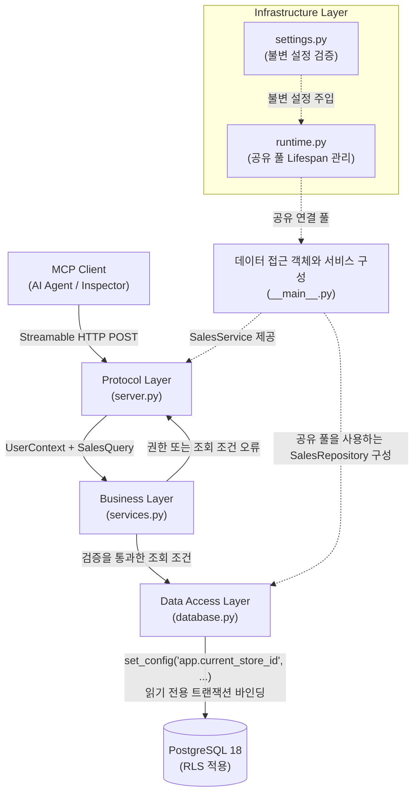

# Zava MCP Server

PostgreSQL의 행 수준 보안(Row-Level Security, RLS)을 적용해 매장별 소매 데이터를 분석하는 Model Context Protocol(MCP) 서버 패키지입니다.

---

## 목차 (Table of Contents)

1. [개요 및 아키텍처](#1-개요-및-아키텍처)
2. [제공 도구 명세 (`get_top_products`)](#2-제공-도구-명세-get_top_products)
3. [빠른 시작 및 실행](#3-빠른-시작-및-실행)
4. [환경변수 상세 레퍼런스](#4-환경변수-상세-레퍼런스)
5. [코드 품질 및 테스트 기준](#5-코드-품질-및-테스트-기준)

---

## 1. 개요 및 아키텍처

서버는 단일 책임 원칙과 보안 분리 원칙에 따라 4대 계층으로 설계되었습니다. 비즈니스 계층의 권한 검증을 통과하기 전에는 데이터베이스 연결을 풀에서 대여하지 않는 **조기 거부(Early Reject)** 원칙을 철저히 준수합니다.



### 계층별 핵심 역할과 보안 가드레일

- **Protocol Layer (`server.py`)**: MCP 서버 객체를 구성하고 `get_top_products` 도구를 등록합니다. Pydantic으로 입력 형식을 검증한 뒤 서비스를 호출합니다. 서비스에서 발생한 권한 또는 조회 조건 오류는 도구가 `ToolError`로 변환합니다.
- **Business Layer (`services.py`)**: 사용자 정보(`UserContext`)의 작업 권한(`sales:read`), 매장 접근 권한(`allowed_store_ids`), 그리고 조회 기간(1~366일)을 검증합니다. 조건을 만족하지 못하면 DB 연결을 빌리기 전에 요청을 즉시 거부합니다.
- **Data Access Layer (`database.py`)**: 비즈니스 검증을 통과한 요청에 한해 풀에서 연결을 대여합니다. 동일 연결의 읽기 전용 트랜잭션 안에서 `set_config('app.current_store_id', $1, true)`로 매장 ID를 바인딩하여 RLS 격리를 적용하며, 조회가 끝나면 즉시 연결을 반환합니다.
- **Infrastructure Layer (`settings.py`, `runtime.py`)**: 환경변수를 Pydantic 불변 객체로 검증하고, 서버 수명주기(Lifespan) 동안 공유 DB 연결 풀 하나를 안전하게 관리합니다. 비밀번호를 로그에 절대 평문 출력하지 않습니다.

---

## 2. 제공 도구 명세 (`get_top_products`)

현재 서버가 외부에 제공하는 핵심 분석 도구입니다.

* **도구 역할**: 지정한 매장과 기간의 주문 상세 거래 금액(`order_items.total_amount`)을 상품별로 합산하여 매출 상위 상품 순위를 반환합니다. 집계 금액 동률 시 상품 ID 오름차순으로 정렬합니다.

### 입력 파라미터 규격

| 파라미터 | 타입 | 제약 조건 | 설명 |
| :--- | :--- | :--- | :--- |
| `store_id` | `int` (`StrictInt`) | 양의 정수, 사용자 허용 매장 목록 포함 필수 | 조회 대상 매장 ID |
| `start_date` | `str` (`ToolDate`) | `YYYY-MM-DD` 정규식 일치, 유효한 달력 날짜 | 집계 시작일 (포함) |
| `end_date` | `str` (`ToolDate`) | `YYYY-MM-DD` 정규식 일치, 시작일 ≤ 종료일, 최대 366일 | 집계 종료일 (포함) |
| `limit` | `int` (`StrictInt`) | 1 이상 20 이하의 정수 | 반환할 최대 상품 수 |

### 정상 반환 결과 예시 (`structuredContent`)

매장 1의 2020년 1월 매출 상위 상품 두 개(`limit: 2`)를 조회한 결과입니다.

```json
{
  "store_id": 1,
  "start_date": "2020-01-01",
  "end_date": "2020-01-31",
  "products": [
    {
      "product_id": 400,
      "product_name": "Heavy Duty Workbench 6-foot",
      "total_amount": "4044.96"
    },
    {
      "product_id": 403,
      "product_name": "Garage Workbench Kit",
      "total_amount": "3897.79"
    }
  ]
}
```

* `total_amount`는 부동소수점 오차를 방지하기 위해 데이터베이스의 정확한 `Decimal` 값을 소수점 문자열로 유지합니다.
* 조회 기간 내 거래가 없는 경우 `products`는 빈 배열(`[]`)로 정상 반환됩니다.

> [!TIP]
> **호출 실패 시 점검 사항 (`ToolError`)**
> - **날짜 및 조건 오류**: 날짜가 `YYYY-MM-DD` 형식인지 확인하세요. 조회 기간은 시작일과 종료일을 모두 포함해 최대 366일입니다. 두 날짜가 같으면 하루를 조회합니다. `limit`은 1~20 사이의 정수여야 합니다.
> - **매장 권한 없음**: 개발용 사용자(`config/dev-user.json`)의 `allowed_actions`에 `sales:read`가 있고, `allowed_store_ids`에 요청한 매장 ID가 포함되어 있는지 확인하세요.
> - **시간 초과 또는 DB 오류**: PostgreSQL 연결 상태와 조회 계정(`zava_mcp_reader`)의 권한을 확인하세요.

---

## 3. 빠른 시작 및 실행

아래 작업은 프로젝트 루트에서 실행합니다. 실행 중인 PostgreSQL에 실습 스키마와 조회 전용 계정(`zava_mcp_reader`)이 필요합니다. 예제의 조회 결과를 확인하려면 실습 데이터도 적재되어 있어야 합니다. [데이터베이스 설계와 구축](../walkthrough/04-Database/README.md)

### 3.1 환경 동기화 및 설정 파일 준비

```powershell
uv sync --locked

# 로컬 설정 파일이 없으면 예시 파일을 복사해 준비합니다
if (-not (Test-Path -LiteralPath .env.reader)) {
    Copy-Item -LiteralPath .env.reader.example -Destination .env.reader
}
if (-not (Test-Path -LiteralPath config/dev-user.json)) {
    Copy-Item -LiteralPath config/dev-user.example.json -Destination config/dev-user.json
}
```

* **`.env.reader`**: 예시 값을 실제 PostgreSQL 호스트, 포트, 데이터베이스 이름, 조회 전용 계정과 비밀번호로 바꾸세요. 관리자 접속 정보는 `.env`에서 별도로 관리합니다.
* **`config/dev-user.json`**: 개발용 사용자의 작업 권한과 매장 접근 권한을 설정합니다. 서버는 모든 로컬 호출에 이 설정을 적용합니다. 아래 예시는 매장 1의 매출 조회를 허용합니다.

```json
{
  "user_id": "dev-manager",
  "allowed_actions": ["sales:read"],
  "allowed_store_ids": [1]
}
```

### 3.2 서버 실행

프로젝트 루트의 첫 번째 터미널에서 서버를 실행합니다.

```powershell
uv run --locked --env-file .env.reader python -m zava_mcp_server
```

> [!IMPORTANT]
> **네트워크 보안 제약**: 서버는 DNS 리바인딩 방어를 위해 `127.0.0.1`에서만 실행되며, `Host`는 `127.0.0.1:<실행 포트>`와 일치해야 합니다. `Origin` 헤더가 있다면 `http://127.0.0.1:<실행 포트>`와 일치해야 합니다. (서버 종료는 터미널에서 `Ctrl+C` 입력)

### 3.3 도구 검증

서버가 실행 중인 상태에서 프로젝트 루트에 두 번째 터미널을 엽니다. `MCP_PORT`나 `MCP_PATH`를 변경했다면 두 방법 모두 변경한 포트와 경로로 접속하세요.

#### 방법 1: CLI로 도구 등록 확인

```powershell
uv run --locked python scripts/check_mcp_server.py http://127.0.0.1:8000/mcp
```

`["get_top_products"]`가 출력되면 서버에 연결해 등록된 도구 목록을 확인한 것입니다.

#### 방법 2: 공식 MCP Inspector 인터랙티브 검증 (추천)
브라우저에서 도구를 호출하려면 Node.js 22.19.0 이상이 필요합니다. [MCP Inspector 공식 안내](https://github.com/modelcontextprotocol/modelcontextprotocol/blob/main/docs/docs/2026-07-28/tools/inspector.mdx#quickstart)

```powershell
npx @modelcontextprotocol/inspector
```

1. 브라우저에서 서버를 추가하고 전송 방식은 `Streamable HTTP`, URL은 `http://127.0.0.1:8000/mcp`로 설정한 뒤 연결합니다.
2. 도구 목록을 열고 `get_top_products`를 선택합니다.
3. `store_id: 1`, `start_date: 2020-01-01`, `end_date: 2020-01-31`, `limit: 2`를 입력하고 도구를 실행합니다. 결과를 2절의 예시와 비교하세요.

---

## 4. 환경변수 상세 레퍼런스

서버 환경변수는 `.env.reader` 파일에 설정합니다. 기본값이 표시된 항목은 생략할 수 있습니다.

| 환경변수 | 기본값 | 유효 조건 | 설명 |
| :--- | :--- | :--- | :--- |
| `POSTGRES_HOST` | *(필수)* | 비어 있거나 공백만 있는 값은 허용하지 않음 | PostgreSQL 호스트 주소 |
| `POSTGRES_PORT` | *(필수)* | 정수, 1~65,535 | PostgreSQL 포트 번호 |
| `POSTGRES_DB` | *(필수)* | 비어 있거나 공백만 있는 값은 허용하지 않음 | 데이터베이스 이름 |
| `POSTGRES_USER` | *(필수)* | `zava_mcp_reader` | 조회 전용 계정 이름 |
| `POSTGRES_PASSWORD` | *(필수)* | 비어 있지 않은 비밀 문자열 | 조회 전용 계정 비밀번호 (`SecretStr`) |
| `MCP_HOST` | `127.0.0.1` | `127.0.0.1` 고정 | HTTP 바인딩 호스트 (루프백 제한) |
| `MCP_PORT` | `8000` | 정수, 1~65,535 | HTTP 서비스 포트 |
| `MCP_PATH` | `/mcp` | `/`로 시작. `//`로 시작하거나 공백, 쿼리, 프래그먼트, 역슬래시를 포함할 수 없음 | MCP 엔드포인트 URL 경로 |
| `DEV_USER_FILE` | `config/dev-user.json` | UTF-8 JSON 파일 경로 | 상대 경로는 프로젝트 루트 기준 해석 |
| `DB_POOL_MIN_SIZE` | `1` | 0 이상의 정수 | DB 연결 풀 최소 연결 수 (`MIN <= MAX`) |
| `DB_POOL_MAX_SIZE` | `5` | 1 이상의 정수 | DB 연결 풀 최대 연결 수 |
| `DB_CONNECT_TIMEOUT`| `10`초 | 유한한 양수 (소수 가능) | 새 DB 연결 생성 제한 시간 |
| `DB_ACQUIRE_TIMEOUT`| `5`초 | 유한한 양수 (소수 가능) | 풀에서 연결 대여 대기 시간 |
| `DB_QUERY_TIMEOUT`  | `10`초 | 유한한 양수 (소수 가능) | 개별 쿼리 실행 제한 시간 |
| `DB_SHUTDOWN_TIMEOUT`| `10`초 | 유한한 양수 (소수 가능) | 서버 종료 시 풀 안전 종료 대기 시간 |

---

## 5. 코드 품질 및 테스트 기준

코드를 변경한 뒤 Ruff로 린트와 서식을 검사하고, mypy로 타입을 검사합니다. 단위 테스트는 DB 대역으로 도구 응답, 권한 검사, 연결 풀 처리를 확인합니다. 실제 DB 조회는 3절의 Inspector 호출로 확인할 수 있습니다.

```powershell
# 1. 정적 분석 및 서식 검사
uv run --locked ruff check zava_mcp_server
uv run --locked ruff format --check zava_mcp_server
uv run --locked mypy zava_mcp_server

# 2. 패키지 단위 테스트 실행 (DB 대역 기반 격리 테스트)
uv run --locked pytest tests/test_server.py tests/test_services.py tests/test_database.py tests/test_runtime.py -q -o asyncio_default_fixture_loop_scope=function
```

> [!NOTE]
> 린트와 타입 검사 설정은 [pyproject.toml](../pyproject.toml)에서 확인할 수 있습니다.
